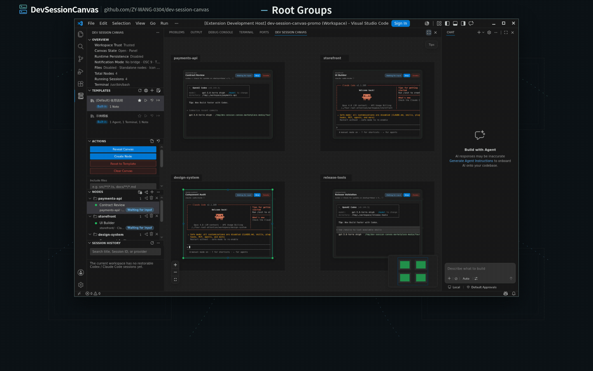

# DevSessionCanvas

English | [简体中文](README.zh-CN.md)

> **Temporary VS Code Marketplace notice**
>
> DevSessionCanvas is temporarily unavailable on the VS Code Marketplace due to an unknown marketplace availability issue.
>
> - Install from [GitHub Releases](https://github.com/ZY-WANG-0304/dev-session-canvas/releases): download the `.vsix`, then run `Extensions: Install from VSIX...`.
> - Open VSX is not affected.
>
> **VS Code Marketplace 临时说明**
>
> 由于未知的 Marketplace 可见性问题，DevSessionCanvas 暂时无法在 VS Code Marketplace 上线。
>
> - 可从 [GitHub Releases](https://github.com/ZY-WANG-0304/dev-session-canvas/releases) 下载 `.vsix`，再通过 `Extensions: Install from VSIX...` 安装。
> - Open VSX 市场不受影响。

DevSessionCanvas is a multi-session collaboration canvas extension for VS Code. It provides a shared canvas that gives `Agent` and `Terminal` sessions a global view, helping you manage multiple development execution sessions inside a single workspace.

The product is in public `Preview`. The release-prep target is `0.28.0`, following the published `0.27.0` baseline. This update clarifies title editing, improves terminal shortcut input, and retires automatic file activity while preserving independent file workflows. It is intended for advanced users who can prepare their CLI environment and accept Preview limitations.



## Who It Is For

- Developers who need to run multiple `Agent` or terminal sessions in parallel inside the same VS Code workspace
- Users who want a canvas-level global context instead of switching back and forth between terminal tabs
- Advanced users who are willing to use a `Preview` build and can prepare `codex` or `claude` CLI themselves

## What The Preview Includes

- A primary canvas that defaults to the `panel` route and can also be switched back to the editor area
- A minimal working path for `Agent` and `Terminal` nodes
- Lightweight `Note` nodes for supporting collaboration
- Basic canvas interaction and layout built on React Flow
- Dynamic global overview zoom and configurable low-zoom overview rendering, so fit view can still show the full canvas when nodes are spread out
- `Note` nodes with Markdown syntax support
- `Note` nodes can be associated with `.md` / `.markdown` files in the workspace, with YAML metadata popovers and safe Markdown image previews
- Canvas templates with built-in default templates, custom template save / import / export, a template sidebar, reset entry points, and explicit save modes for associated Markdown Notes
- Canvas groups for naming, nesting, moving, resizing, and browsing related `Agent` / `Terminal` / `Note` nodes as larger work areas
- Multi-root workspace composition that shows each workspace folder as a system root section with optional root-name watermarks while preserving root-local canvas state
- Optional multi-root pane-gallery presentation with dynamic / grid overviews and top / side thumbnail modes for inspecting multiple roots
- Spatial fit view and MiniMap navigation that include nodes, user groups, and workspace-root sections
- One-shot canvas layout arrangement from the canvas context menu, respecting group and workspace-root boundaries
- Scope-aware canvas clearing for the current group, current workspace root, or entire workspace, with explicit confirmation before destructive changes
- Cross-platform shell-environment inheritance and diagnosable launch paths for `Agent` and embedded `Terminal` nodes
- File Explorer context-menu entries that create cwd-scoped `Terminal` or `Agent` nodes from workspace folders or files
- Execution-terminal copy / paste shortcuts that preserve platform-native copy, paste, and `Ctrl+C` interrupt semantics, plus screenshot paste for live `Agent` nodes
- Execution-terminal link detection for native-style URLs, file paths, multiline line-number output, high-confidence TUI hard-wrapped URL / styled-file fragments, live-output file-link cache refresh, click-time fallback search, and native VS Code opening for text or media targets
- Live PTY title display for `Agent` and `Terminal` nodes, including `CSI 21 t` title queries and owner-side `OSC l` reports without persisting title payloads as terminal output
- Stable Agent / Terminal resize submission that previews the node frame live while coalescing PTY character-grid changes and avoiding provider redraws for position-only moves
- Foreground-priority output scheduling and tmux-like reattachment to healthy persistent sessions: import the current terminal state directly without replaying accumulated output; completed persistent Runtime sessions reopen with node configuration and exit status only
- Sidebar and command-palette entry points for selecting `Codex` / `Claude Code` CLI commands, opening their config files, and separating stopped-node `New` versus `Resume` actions
- Codex / Claude Code Agent `Fork` from a trusted session id into a new Agent node that starts with provider-native fork semantics and supports configurable up/down/right placement for current-node forks
- Automatic CLI selection / installation recovery when an `Agent` launch cannot resolve the requested CLI
- Multi-section desktop-notification companion sidebar with platform onboarding and `Codex` / `Claude Code` notification-configuration guidance
- Limited capability handling under `Restricted Mode`
- Public `Preview` distribution through GitHub Releases and Open VSX; Visual Studio Marketplace is deferred
- Sidebar `Nodes` and `Session History` lists that let users jump to canvas nodes and restore or fork a new `Agent` node from history
- Sidebar workspace-folder actions for adding folders, creating or adding git worktrees, distinguishing repository / linked-worktree roots, and removing workspace folders or linked worktrees through explicit confirmations
- Template Marketplace Preview flows for browsing templates, installing complete template packages, updating or rolling back installed marketplace templates, and publishing saved local templates when GitHub authentication is available
- English-default UI copy with Simplified Chinese localization for product-owned VS Code entries, host messages, sidebar surfaces, and the main canvas Webview

## What The Preview Does Not Include

- A stable-release guarantee
- `Virtual Workspace` support
- A zero-configuration out-of-the-box experience for all users
- A stable-release-grade support commitment across all three desktop platforms
- A full stable-release delivery process

Rapid repeated window reopens can delay Canvas loading in affected VS Code versions. Persistent startup failures may leave a blank canvas; automatic startup timeout feedback and rebuilding are not provided. Shared-canvas and takeover evidence remains limited; see the release contract for its scope.

## Runtime Requirements

- VS Code `1.80.0` or later
- A standard filesystem workspace, either on local disk or in a `Remote SSH` workspace
- The required CLI runtime:
  - `Agent` nodes depend on `codex` or `claude`
  - `Terminal` nodes depend on a local shell
- A trusted workspace
  - In an untrusted workspace, the canvas can still be opened, but execution entry points are disabled

## Agent Provider Snapshot

This README keeps the comparison user-facing and brief. The full technical checklist lives in [`docs/design-docs/agent-provider-capability-matrix.md`](docs/design-docs/agent-provider-capability-matrix.md).

| Feature | Codex | Claude Code |
| --- | --- | --- |
| CLI Agent | ✅ `codex` | ✅ `claude` |
| Launch presets | ✅ 5 modes | ✅ 5 modes |
| Resume | ✅ Explicit | ✅ Explicit |
| Fork | ✅ Native | ✅ Native |
| Session history | ✅ Workspace | ✅ Workspace |
| Notifications | ✅ Signals + errors | ✅ Signals + exits |
| Notable limit | Windows history scroll | - |

## Project Status

The project has completed its initial research, design, and MVP validation and is in public `Preview`. See the [0.28.0 release contract](docs/release-contracts/v0.28.0.md) and [main extension changelog](extensions/vscode/dev-session-canvas/CHANGELOG.md) for the current release-prep scope. The latest published version remains `0.27.0` until publication. There is no stable-release commitment.

Explicit conclusions:

- The current version is `Preview`, not a stable release.
- `Restricted Mode` is supported with limited capability messaging. Execution entry points such as `Agent` and `Terminal` are disabled in an untrusted workspace.
- `Virtual Workspace` is not supported. `vscode.dev`, GitHub Repositories, and other purely virtual filesystem windows are outside the release scope.
- GitHub Releases and Open VSX are the current required release targets. Visual Studio Marketplace is deferred and the current release workflow does not query or submit to that channel.
- Declared Linux, macOS, Windows, and Remote SSH paths have Preview validation. Native assets cover Linux glibc, macOS, and Windows on x64/arm64; modern-system evidence does not establish older-system or musl compatibility. Windows Codex history cannot page upward yet. Release verification must still run on the PR merge result and final tag.
- The product still depends on local CLI availability and workspace-extension runtime conditions, so it is better suited to advanced users who can prepare `codex` or `claude` CLI themselves.

Related entry points:

- Release playbook: [`docs/public-preview-release-playbook.md`](docs/public-preview-release-playbook.md)
- Public support boundaries: [`docs/support.md`](docs/support.md)
- Design conclusions and release judgment: [`docs/design-docs/public-marketplace-release-readiness.md`](docs/design-docs/public-marketplace-release-readiness.md)

## Preview Distribution

Public distribution currently uses GitHub Releases and Open VSX as required release targets. Visual Studio Marketplace is deferred until its publishing path is restored; the current workflow does not query or submit packages there. `.vsix` files are otherwise kept as build artifacts and release-verification inputs rather than ordinary distribution files.

- Public `Preview` users should install through the extension registry configured by their host rather than by manually distributing a `.vsix`
- `Visual Studio Marketplace` remains deferred and must not be announced as available; GitHub Releases and verified Open VSX are the current required release targets
- `Open VSX` does not change the official VS Code Marketplace path and does not expand the compatibility-support matrix by itself

## Desktop Notification Companion (Auto-Installed)

Installing `Dev Session Canvas` automatically installs the companion extension `Dev Session Canvas Notifier` (`devsessioncanvas.dev-session-canvas-notifier`). If a user installs from the notifier page first, VS Code also auto-installs the main extension `Dev Session Canvas`.

- Execution-node attention signals now prefer the local desktop by default through `devSessionCanvas.notifications.attentionSignalBridge = system`; switch the setting if you want `workbench` or `none`, or narrow attention sources with `devSessionCanvas.notifications.enabledAttentionSignals`
- In `system` mode, the main extension prefers the local UI-side notifier companion and falls back to workbench notifications when the companion is missing, unsupported, or delivery fails
- The companion is especially useful in `Remote SSH`, WSL, and Dev Container scenarios where the main extension runs on the workspace side but the notification must return to the local desktop
- Notifier-specific release and verification guidance lives in [`docs/notifier-preview-release-playbook.md`](docs/notifier-preview-release-playbook.md)

## Build From Source And Install For Development

For developers, the recommended path is to build from source and install through an Extension Development Host, rather than manually installing a `.vsix`.

Prepare the matching six-target native runtime assets as described in [CONTRIBUTING.md](CONTRIBUTING.md#本地准备), then run:

```bash
npm install
npm run build
```

Then in the repository window:

1. Open `Run and Debug`
2. Select `Run Dev Session Canvas (Main Only)`
3. Press `F5` to launch the `Extension Development Host`

For more complete instructions on source development, `Remote SSH` debugging, and automated verification, see [CONTRIBUTING.md](CONTRIBUTING.md).

## Known Limitations

- The product is still in `Preview` and should not be treated as a stable production tool.
- `Virtual Workspace` is not supported.
- The public `Preview` distribution currently uses GitHub Releases and same-version Open VSX publication as required targets. Visual Studio Marketplace remains deferred until the publishing path is restored; see the release workflow and current release contract for the applicable gate.
- Persistent recovery depends on the setting and backend. Supervisor crashes, machine restarts, and power loss do not guarantee recovery of the original process or terminal history. Existing live sessions retain their original binding. Snapshot-only processes do not survive Host lifecycle boundaries, and cross-version data rollback is not guaranteed.
- Directed current-node Fork placement has automated geometry and interaction coverage, but final visual review of layer spacing and `fork` labels across panel and editor surfaces is still pending.
- PNG execution links have real VS Code Host coverage, while GIF / MP4 use the same native opener without separate real-host fixtures. A resolved `vscode.open` command only confirms editor-service acceptance, not final model load success.
- Resize coalescing has Webview regression and trusted Host smoke evidence, but still needs manual journal review with real Codex / Claude TUI processes. Multi-touch across different nodes or Pane Gallery surfaces is not currently supported.
- Declared 90,000-line exit completion and real Agent reload paths have targeted validation, without arbitrary-concurrency or output-volume guarantees. Resources scale with active sessions, terminal size, and scrollback; there is no fixed total memory/disk cap or zero-latency recovery.
- Template Marketplace remains a Preview capability. It may require network access to `https://dscanvas.dev`, GitHub authentication for write actions, and production catalog data created through the marketplace or a controlled operations flow.
- The `Remote SSH` main path is validated and usable, and it remains the most strongly validated recommended path. Linux, macOS, and Windows local main paths also have functional validation now, but Windows still has a known limitation where embedded `Codex` history cannot page upward.
- `Note` Markdown preview does not support raw HTML passthrough, arbitrary link schemes, file links outside the current workspace, directory targets, or rich-text block editing.
- Templates currently save static layout and configuration only; they do not save running sessions, terminal output, thumbnails, cloud sync, or template history.
- The first execution-terminal copy / paste shortcut release does not read custom user keybindings, and it does not cover Linux selection clipboard, right-click copyPaste, or HTML rich-text copying.
- The sidebar `Session History` list only shows `Codex` / `Claude Code` records that can be explicitly attributed to the current workspace; older sessions without working-directory metadata are skipped conservatively.
- If the machine does not have a usable `codex` or `claude` CLI, `Agent` nodes cannot provide the full experience.

## Support Matrix

| Scenario | Status | What Users Should Expect |
| --- | --- | --- |
| `Remote SSH` workspace | `Preview`, main path validated and best-validated | Users can try the main canvas, `Agent`, `Terminal`, and recovery flows; this remains the most recommended environment |
| Linux local workspace | `Preview`, main path validated | The local canvas, `Agent`, and `Terminal` main path already has Preview functional validation evidence |
| macOS local workspace | `Preview`, main path validated | The local canvas, `Agent`, and `Terminal` main path already has Preview functional validation evidence |
| Windows local workspace | `Preview`, main path validated with known limitation | The local canvas, `Agent`, and `Terminal` main path already has Preview functional validation evidence, but embedded `Codex` history still cannot page upward |
| `Restricted Mode` | Limited support | The canvas can be opened and saved layouts can be viewed, but execution entry points such as `Agent` and `Terminal` are disabled |
| `Virtual Workspace` | Unsupported | Outside the Preview scope |

## Capability Boundaries

- `Agent` nodes require `codex` or `claude` CLI that can be resolved by the local or remote Extension Host
- `Terminal` nodes require a shell environment available on the workspace side. macOS / Linux inherit a controlled shell env patch by default, while Windows lets the real shell run profile / AutoRun itself; `devSessionCanvas.terminal.inheritEnv` and `devSessionCanvas.terminal.shellArgs` provide explicit controls
- ordinary `Note` nodes keep raw Markdown text in canvas state as the authoritative body data; associated Markdown Notes use `.md` / `.markdown` files on disk as the authoritative source, and preview-mode links are limited to allowlisted external schemes and files inside the current workspace
- `devSessionCanvas.runtimePersistence.enabled = false`: baseline capability only, with no promise that real processes continue across VS Code lifecycle boundaries
- `devSessionCanvas.runtimePersistence.enabled = true`: local Linux and `Remote SSH` require linger and verified user-service ownership before starting new persistent sessions. Missing or unknown prerequisites block new starts instead of silently falling back to detached execution. Existing sessions remain accessible; other supported environments retain their best-effort behavior. Reopen tests alone do not prove survival after the final OS login ends.

On Linux, use **Dev Session Canvas: Configure Background Persistence** from the Command Palette to open setup. Opening the guide automatically checks your environment and selects the next task: **Allow background services → Enable Runtime Persistence → Reload to apply → Verify the result**. There is no separate host-check step. When the environment is already ready, **Allow background services** stays visible and is checked off automatically. Normal checks do not open another panel; failures show diagnostics. **Check again / view details** displays the actual host, user, UID, system status, effective setting and applied window mode in **Background persistence** Output.

Clicking **Runtime Persistence** in the sidebar opens the turn-off guide when this window has applied persistent mode, or setup when it has not. A pending change continues in its requested direction. Status distinguishes applied, off, pending and unavailable/unverified background services; checking the setting alone is not treated as enabled. Having no running sessions or losing linger does not make an applied mode off. To repair prerequisites without turning off, right-click the item and choose **Configure Background Persistence**. Opening either guide does not change settings, stop sessions or modify linger.

**Linger alone does not enable the extension setting.** Select **Open setting**, choose the intended scope in native Settings and check **Runtime Persistence: Enabled**. Return to the guide and continue. If the setting is enabled but not yet applied, the guide offers **Review and reload…** with the existing warning: switching modes clears this window’s Canvas sessions and content. Setup is verified only when the host, setting and running window all pass. Walkthrough checkmarks are saved progress, not live status; select **Check again** after reloading or changing hosts.

The linger step offers one primary action and secondary links to copy the command or use sudo. Execution requires confirmation of the exact target and command, then runs in a dedicated VS Code terminal. The default command does not use sudo; the administrator option requires its own explicit confirmation. Passwords are entered only in the terminal, never collected by the extension. Enabling linger affects the account's other user services too; disabling or uninstalling this extension does not disable linger. It does not preserve processes through a reboot. An older Supervisor can still serve existing sessions but cannot accept new login-independent sessions until it exits and a compatible Supervisor is started; the extension does not restart it automatically.

To stop using persistent mode, run **Dev Session Canvas: Turn Off Runtime Persistence…**, follow the **turn-off guide** link in setup, or use the Runtime Persistence sidebar item's context menu. Opening the separate guide automatically checks the setting and running mode, then selects the next task in **Turn off the setting → Review and reload → Verify this window is off**. Other participating windows keep their shared sessions; the last enabled window explicitly turning off clears shared sessions and content and exits the Supervisor. Cancelling reload does not revert the saved setting: closing or restarting the Canvas/window still applies it. Recheck the setting to withdraw a pending request.

Turning off the extension does not change system linger. The final step offers an optional **read-only** rollback report with the actual host/account and, when verified, manual commands. It never executes them or determines that unrelated services no longer need linger; review those dependencies with your administrator.

## Feedback And Contact

- Scope, required environment details, and support boundaries before filing an issue: [`docs/support.md`](docs/support.md)
- Bugs and feature feedback: <https://github.com/ZY-WANG-0304/dev-session-canvas/issues>
- Security issues: `wzy0304@outlook.com`
- Feishu discussion group:

  

- WeChat discussion group:

  

## Development And Contribution

Development setup, local debugging, main-path verification, and commit conventions are documented in [CONTRIBUTING.md](CONTRIBUTING.md).

If you want to continue development, start with `docs/WORKFLOW.md`, `ARCHITECTURE.md`, and `docs/PRODUCT_SENSE.md`.

## Background And Motivation

The direct inspiration for this project came from [OpenCove](https://github.com/DeadWaveWave/opencove). Its approach of managing multiple development sessions on a single canvas was especially compelling. When several terminals are active at once, developers often have to jump back and forth between them just to understand the state and progress of each session.

This project started from the observation that day-to-day development already happens mostly inside VS Code, and that it would be valuable to bring a global multi-session view into that familiar editor workflow. At the time, there was no existing VS Code extension that felt close enough, so building one as an extension became the practical path.

The goal is not to recreate all of OpenCove inside VS Code. The point is to take inspiration from it, then narrow the product around the VS Code context: prioritize global visibility and management for `Agent` and `Terminal` sessions, work with the existing extension ecosystem, and improve the development experience for the AI era.
