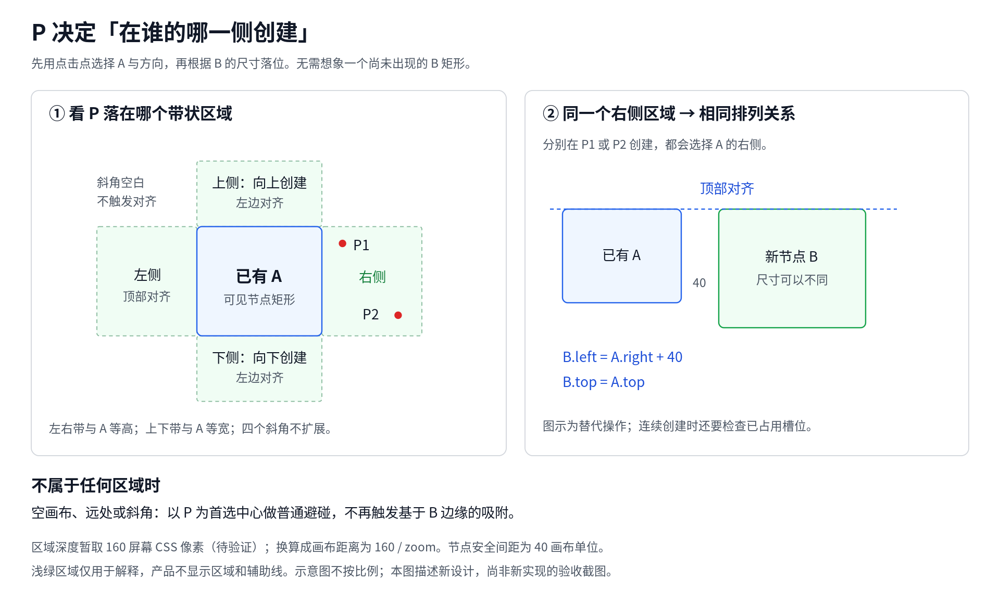
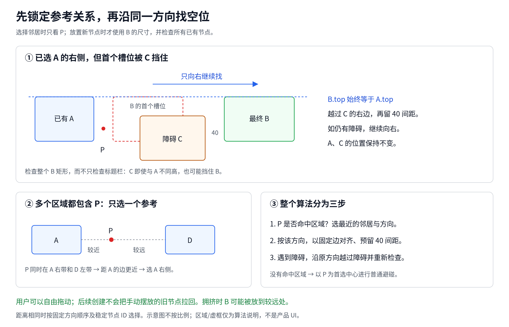

# 新建节点轻量对齐

## 问题与范围

用户要求创建时布局规整，同时保留手动自由摆放。原来 Webview 以视口宽度 50%、高度 55% 的位置（或右键位置）为节点中心，减去默认尺寸的一半后提交首选左上角。宿主没有视口时使用按序号三列、320 × 220 间隔的候选位置。`canvasNodePlacement.ts` 将坐标取整到 20 flow units，并以 120 × 96 的步长搜索；方向优先级排在距离之前，所以连空白位置也可能先偏移到右下方。候选未参考邻居边缘，网格取整不等于节点对齐。

P 分区对齐覆盖普通 Agent、Terminal、Note 的右键创建。历史会话、命令、关联 Markdown Note 等非右键入口保留首选位置和普通避碰，不伪造 P。Fork 使用已有定向同层算法，模板整体保留内部布局。恢复、拖拽、缩放、resize 和显式整理命令不接入本算法。普通 group 仍执行既有外框扩容和冲突修复；这里只保证节点初始落位，不能将 group 修复误称为本次新增的全局整理。

## 正式方案

用户在看过右键定位图后指出：用户无法直观计算 B 的首选矩形，因而无法预判同一个操作什么时候会对齐。2026-11-04 用户认可了以 P 选择邻居和方向、沿该方向对齐避碰的方案，并要求用图形说明算法。实现已替换先前的 B 矩形吸附；自动化覆盖共享几何、协议、宿主创建及浏览器消息，实际 VSCode 手感和跨平台人工验收尚未执行，因此标记为 `验证中`。

### 图解：P 如何决定排列关系

左图中的 P₁、P₂ 是同一个画布初始状态下的两种替代点击：它们都选中 A 的右侧，所以右图的 B 顶部都与 A 对齐。B 类型或尺寸改变，不改变参考邻居和方向。若连续执行两次创建，第二次会把第一次产生的节点当作障碍，按下面的规则继续寻找空位。

### 图解：障碍与多个邻居

上图先由 P 选中 A 的右侧，再使用 B 的完整矩形检查碰撞。C 即使未与 A 顶部对齐，也可能挡住 B；越过 C 后 B 仍保持 A.top，不改向下方。下图说明多个区域同时命中时只选一个参考关系；整个选择发生在计算 B 的位置之前。

仓库仅保存本文使用的两张 PNG，不管理 SVG 生成源文件。文档图片不依赖 `/tmp`；`/tmp/canvas-node-alignment/` 中的生成文件与预览副本仅供本地使用。图中区域、虚框和辅助线用于解释，不是产品新增 UI；示意图不按比例。

### 用户规则

P 选择一个已有节点及其一侧，系统沿该侧创建对齐的新节点。右侧和左侧顶部对齐，下侧和上侧左边对齐；相邻节点间距为 40 画布单位。选定关系后不再区分“B 的首选矩形是否碰撞”，B 的类型和尺寸不参与邻居或方向选择，只参与实际落位和避碰。

### P 的四个区域

对已有节点 A 的可见矩形，在四条边外各取一个有限宽度的带状区域。左右区域的高度与 A 相同，上下区域的宽度与 A 相同。P 落在右带则向右，左带则向左，上带则向上，下带则向下；斜角处不扩展区域，避免模糊方向。`common/canvasNodePlacement.ts` 的 `resolvePointerNodePlacementReference()` 使用 `CANVAS_NODE_CREATION_REGION_DEPTH = 160` 屏幕 CSS 像素，画布距离为 `160 / zoom`。区域外侧边界包含，侧向范围含两端；P 必须严格在 A 对应边外，A 内部或边缘本身不命中。多个邻居命中时先按到边的距离，再按右、下、左、上，最后按节点 ID 的字符串顺序选择。160px 的手感仍待人工确认，不能把自动化验证的计算正确性当作体验已确认。

点在同一个邻居同一侧区域内的不同 P，以及从该 P 创建不同类型的 B，均选择相同的邻居和方向。右带的最终左上角是 `(A.right + 40, A.top)`；下带是 `(A.left, A.bottom + 40)`。左带和上带根据 B 的实际宽高向外扣除，保证其右边或下边与 A 相隔 40。

P 不属于任何区域（空画布、远处或斜角）时，仍以 P 为首选中心做普通避碰，不再根据 B 矩形临时触发另一套边缘吸附。区域选择只参考当前目标 root-local 内的普通节点，不把其他 root 或 group 外框当作参考节点。

### 选定方向上的障碍

选定 A 及方向后，`resolveDirectionalNodePosition()` 检查该对齐槽位与所有已有节点的矩形安全间距。被占用时保持同一行或列，沿选定方向向外越过障碍，直到找到空位；不修改输入节点，不因为 B 尺寸不同而改成其他方向。右/左方向保持 A.top，下/上方向保持 A.left，保留非网格坐标，不二次取整破坏精确对齐。障碍沿移动方向按近边排序并单次扫描；每次碰撞后放到障碍远边加安全间距，已越过的障碍不会再碰到。参考选择与定向落位均为 O(n log n) 时间、O(n) 空间，无固定槽位次数限制。拥挤时 B 可能被放到较远位置，不保证始终紧邻 P。

### 接线与验收要求

`webview/main.tsx` 的 `handlePaneContextMenu()` 保存未取整的 P 和该 surface 的 zoom，`canvasTypes.ts` 中的菜单状态保留这两个值。`webview/createDemoNode` 新增可选 `creationAnchor: { position, zoom }`；原 `preferredPosition` 仍发送，以兼容已有创建/聚焦路径。`common/protocol.ts` 校验坐标有限、zoom 有限且大于零；非法载荷拒绝，缺少新字段的旧消息保持有效。菜单因窗口边界而移位不改变 P；菜单项点击坐标不参与定位。

`CanvasPanelManager.handleActiveWebviewMessage()` 将 anchor 传入 `applyCreateNode()`；如果已有明确目标 root group，就与首选位置一样转换为 root-local P。仅从 cwd 推断 root 的非鼠标路径不沿用其他 surface 的 P。`createNextState()` 对普通创建调用 `resolveAlignedNonOverlappingNodePosition()`，有 P 时先选关系，无关系时以 P 减半尺寸得到中心落位；没有 P 时沿用原首选位置。普通空位先使用 20 单位网格取整后的锚点，有碰撞才调用旧搜索器；旧搜索边界回退若取整侵入 40 间距，改放到全部节点最右边界加 40。Fork 分支优先，模板不接入该函数。

右键创建到普通 group 时，目标组及祖先链在几何修复阶段保持固定，允许外框扩容而不平移该子树。既有 sibling group 冲突修复可能移动其他组，跨 root 外框扩容也沿用原组合规则；本功能不引入跨组全局整理，不承诺在已有非法 group 几何下冻结所有外框和子树。

新测试覆盖同一区域多个 P 与不同尺寸 B、缩放下区域范围、区域边界、多个邻居竞争、斜角/远处不吸附、障碍下保持行列方向；宿主测试覆盖三类创建、手动移动、group 扩容和多 root 消息到最终坐标。前端验证原 P 与 zoom 经菜单创建发送，包括窗口边缘菜单移位、pan/zoom 后 group 创建、默认和自定义 Agent 创建。恢复/拖拽代码未接入新算法，沿用已有路径。

### 本轮图文验证

两张 PNG 均为 1920 像素宽，已检查中文文字、布局和示意关系。图文说明不构成新算法的运行验证；运行证据见下节。

### Smoke 验收同步

源码与 VSIX 的独立创建 smoke 使用真实扩展宿主的消息入口验证 `creationAnchor`，覆盖 Agent、Terminal、Note 的方向对齐与避障、无 P 空位优先、旧节点自由位置、普通组扩容、多 root 坐标转换，以及显式保存后重读的几何保持。沿用既有执行启动和退役屏障，不向其他生命周期 fixture 注入 P。浏览器负责原 P/zoom 的菜单消息接线，新增用例必须同步 `scripts/gates/browser-catalog.json`；Host smoke 负责消息到状态与持久化。两个层次不宣称已执行实际 VSCode 鼠标右键端到端或跨平台验收。

独立 case 通过 `scripts/smoke/smoke-catalog.mjs` 同时进入 source/packaged 目录；设计 coverage-map 与 implementation-map 同步登记，但登记不等于执行成功。本轮补测结果在验证记录中如实区分源码 Host、VSIX 和分层自动化。

跨 root case 由 source/VSIX runner 打开真实双 root `.code-workspace`，使用产品生成的 root ID 和 `webview/moveGroup` 建立偏移，不把单 root 窗口中注入的 root 外框当成真实持久化环境。补测发现 `flushPersistedCanvasStateForTest()` 原来漏写 `multiRootOverlay`，导致测试 flush 本身抹去根分区位置；现同步保留该字段。该修改只修正受测试模式保护的接口，不改变生产保存逻辑。对应宿主回归在修复前以 `actual: undefined` 失败。

## 验证记录

2026-11-05 PR 准备：已 rebase 到 `origin/main` 的 `72275f0c`。保留主线默认执行节点尺寸，右键浏览器 fixture 的 P 随主线点击点同步为 `(1200, 650)`；当前完整门禁从主线 362 项增加六项 source/packaged 任务至 368 项。预算重新生成，136 个主线旧 suite 的预算及去除行号后的调用证据保持一致，423 个浏览器 ID 与目录完全匹配。

Rebase 后几何、协议、分组、执行上下文、typecheck 与双扩展构建通过；17 项定向浏览器、三项新建源码 smoke 和 saved-size 同轮复验通过。`npm run test:ci-gates` 首轮 212/213：未改动的 `child-owned cleanup may finish inside its separate reserve` 时限断言失败；单独复跑 1/1 通过，首败保留在 `.debug/alignment-pr-ci-gates.log`。未放宽阈值，也未将原因定性为已确认的产品缺陷或环境问题。浏览器/Host 日志分别为 `.debug/alignment-pr-browser.log`、`.debug/alignment-pr-source.log`。

完整第二轮仍为 212/213，本次失败的是同组的 `child-owned cleanup cannot hide late business`。两项一起定向复跑 2/2 通过，但本轮全量 CI 不能宣称全绿。第二轮与定向日志为 `.debug/alignment-pr-ci-gates-repeat.log`、`.debug/alignment-pr-cleanup-isolated.log`；待定位事项已登记到 [技术债追踪](../exec-plans/tech-debt-tracker.md#2026-11-05本地门禁回归-child-owned-cleanup-的计时失败)。不修改该测试或等待阈值，正式 required CI 仍须通过。

2026-11-05 smoke 同步：`canvas-nodes/creation-alignment`、`canvas-nodes/creation-group`、`canvas-nodes/creation-root` 已同时进入 source/packaged 目录、设计 coverage-map、implementation-map 和生成的等待预算。正式任务数从 359 增至 365，映射中的有效目标从 150 增至 153；历史退役目标不变。136 个旧 suite 的等待预算和调用证据除源码行号外完全一致，不延长产品等待。实际 Playwright list 的 423 个 ID 与 browser-catalog 完全匹配，定向 `right-click|canvas group body context menu|manually created nodes` 共 17 项通过。

源码真实 Host 验证在 Linux x64、Node v25.6.0、VSCode 1.137.0 下执行：当前源码重新构建，复用通过 owner/shared-owner/patch 哈希校验的本地 Linux 原生资产。最终同轮三项创建 smoke 加 `canvas-nodes/saved-size` 四项通过；此前定向 `create-quickpick`、`explorer-create`、`layout` 通过。`test:canvas-node-placement`、`test:protocol-webview-messages`、分组与执行上下文回归、runner 环境及 reset fixture 验证通过。日志位于本 worktree 的 `.debug/alignment-source-final.log`、`.debug/alignment-source-regression.log`、`.debug/alignment-root-product.log`、`.debug/alignment-browser-tests.log`。

首败保留：最初在单 root 窗口注入两个根外框，重读正确回到真实 root 范围，已改为真实双 root；之后使用产品移动入口仍发生根位置回退，定位到测试 flush 漏写 overlay。`test-canvas-execution-context.mjs` 的新增回归先以 `actual: undefined` 失败，补字段后与真实双 root smoke 一起通过。未删持久化断言，也未修改生产布局/保存算法。日志见 `.debug/alignment-flush-before.log`、`.debug/alignment-root-product.log`。

本轮属于本地定向验证，VSCode 版本并非正式门禁固定的 1.142.0；未生成当前工作树的冻结计划及同批双 VSIX，因此 packaged 仅完成接线和静态计划验证，未运行当前输入的正式 VSIX / 跨平台 / 完整发布门禁。实际使用手感与真实鼠标右键完整链路仍不在这些自动化结论内。

最终 `npm run test:ci-gates` 211 项全部通过（0 failed / skipped），`typecheck`、文档链接/索引校验、JS 语法和 `git diff --check` 通过。CI 首轮发现的缺预算与固定任务数不匹配均已同步；新增回归明确要求三个 case 在 source/packaged 中独立准备、具备有界预算且不可从正式任务集合消失。日志为 `.debug/alignment-ci-gates-final.log`。

2026-11-04：`npm run test:canvas-node-placement`、`npm run test:protocol-webview-messages`、`node scripts/test/test-canvas-node-groups.mjs`、`node scripts/test/test-canvas-execution-context.mjs`、`npm run typecheck` 均通过。纯几何包括四向不同 P/尺寸、五档缩放、四向多障碍、三种尺寸各连续创建 20 个节点和混合尺寸场景。宿主回归包括真实 `createNextState()`、消息分发到 `applyCreateNode()` 的 root-local 转换，以及原 Fork、模板、分组与执行配置测试。

使用独立浏览器 bundle 执行 Playwright 的 `right-click|canvas group body context menu` 场景：14 项首轮通过；新增窗口边缘场景初次误点 MiniMap，改到 MiniMap 上方仍需菜单移位的空白画布后单独通过，合计 15 项通过。此修正只调整测试点击位置，未改变产品行为。浏览器消息测试与宿主坐标测试组成分层验证，不等同于实际 VSCode 内端到端验收。使用 Node v25.6.0，复用本地依赖及 Chromium 缓存，未执行完整发布门禁。

人工验收路径（尚未执行）：在 panel / editor 中连续创建不同类型节点，平移缩放后从右键创建；将一个节点拖离对齐线并再次创建，确认旧节点保持手动位置。自动化结果不代替实际视觉手感与跨平台验收。
