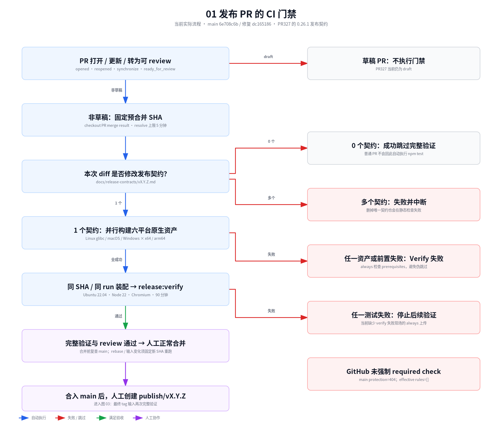

# 0.26.1 发布 CI 门禁流程审查

本次审查覆盖触发、发布输入、六平台资产、验证顺序、测试夹具、超时、失败取证、合并约束和渠道发布/恢复。当前双阶段验证及资产来源核验成立，但门禁尚缺 GitHub 强制合并约束、完整场景范围保护和完整失败取证。已有生产恢复竞态仍须修复；不能仅通过调整 CI 流程或延长等待解决。

本文的“已验证”指流程事实与受控编排核对完成，不表示发布验证通过。建议方案尚未采纳，因此决策状态为“待探索”。本次只交付审查文档、流程图与核对证据，没有修改测试、workflow、产品代码、仓库保护设置，也没有执行发布或最终完整门禁。

## 输入与证据边界

2026-10-15T13:20:52Z 重新 fetch 并读取 GitHub API。审查输入如下；关键实现源文件 hash 保存于 [source-sha256.json](../references/release-gate-flow-audit/source-sha256.json)。

| 输入 | 固定 SHA / 状态 | 用途 |
| --- | --- | --- |
| `origin/main` | `6e708c6b93ce4b2b343729c422f59099f4fb42ba` | 当前主线的 workflow 与门禁基线 |
| 修复 PR335 | `dc1651861dd19dfac47ecbe4989391dc4e993588`，open、非草稿 | 已有 ready 隔离、退役夹具修复与调查证据 |
| 发布 PR327 | `8313fc725c18c28c51c04cc5f4aa5bd9121f290a`，open、draft | 0.26.1 发布契约与发布材料 |

PR327 的发布材料没有被写到当前修复源码，主工作区用户的 `docs/WORKFLOW.md` 修改保持。图中标准 npm test 采用 PR335 的 70 个顶层命令；当前 main 为 68 个，差异是修复新增的两项回归，整体顺序不变。

[GitHub 策略与 PR 输入](../references/release-gate-flow-audit/github-policy-inputs.json) 包含查询时间、端点、状态与 SHA。[受控编排结果](../references/release-gate-flow-audit/orchestration-result.json) 保存验证命令、场景清单和具名 npm script 可达性；其中所有子进程被记录器替代，明确不构成产品测试通过证据。

## 实际 CI 流程图

三张图共同描述当前实际流程。蓝色为自动执行，红色为失败/跳过，绿色为满足验收，紫色为人工协作。右列无连接的方框是审查注记，不是执行阶段。required check 与失败上传的缺口没有被画成已有能力。

| 图 | PNG | 可缩放 SVG | 内容 |
| --- | --- | --- | --- |
| 01 | [发布 PR 门禁](../references/release-gate-flow-audit/pr-gate.png) | [SVG](../references/release-gate-flow-audit/pr-gate.svg) | 草稿/普通 PR、预合并 SHA、资产、verify、人工合并 |
| 02 | [完整验证内部](../references/release-gate-flow-audit/verify-detail.png) | [SVG](../references/release-gate-flow-audit/verify-detail.svg) | 串行测试、19/8 场景、旧代首败、覆盖与取证边界 |
| 03 | [最终 tag 与发布](../references/release-gate-flow-audit/tag-publish.png) | [SVG](../references/release-gate-flow-audit/tag-publish.svg) | tag 再验、同批产物、并行渠道、finalize 与重跑 |

用户要求的逐job执行/验证明细见 [两组CI内部流程说明](../references/release-gate-flow-audit/job-details.md)：六平台各15/16/18步、共同加载检查，以及发布workflow六job的依赖、原YAML步骤、分支条件、失败处理和产物。新增九张可缩放SVG/PNG，`prepare`拆为输入验证与产物交付两图；原生资产job是发布六job中的reusable展开。两组均描述实际代码，没有新增门禁或改变完成条件。

2026-10-16 继续展开 [smoke 内部流程设计](../references/release-gate-flow-audit/smoke/README.md)。输入固定为审查分支 `9aaa05b0`，16份实现源码hash及原调用点见 [smoke/source-map.json](../references/release-gate-flow-audit/smoke/source-map.json)。六张细图分别覆盖源码19/packaged8场景、单Host、trusted/restricted、两阶段重开、双窗口、旧代升级与resize；109/38是两条功能链的直接await调用点数，不是测试数量。图、顺序、hash与链接静态核对通过，PNG逐图视觉检查完成；没有新增产品通过证据。

smoke 的完成条件需按对象区分：surface ready不额外要求bootstrapAck；原终端resize同时核对Host、DOM fit、原RPC行列及session/storage身份；用户Stop要求Host原节点终态，夹具kill不能替代；显式重启另等原存储对象退役；SSH退出/保留两态观察原PID/startTicks，而普通本地重开不具备同等身份控制。最近原样完整运行的首败仍是源码第11场景、图06第8步“Stop后等待Host终态”30秒超时；受控订阅竞态复现不能唯一追认缺少PTY/订阅现场的历史首败。

2026-10-17按用户对01–07的审阅，新增[smoke场景与子场景重划设计](smoke-scenario-boundaries.md)。它提出按验证目标分离链接、停止、退出、重启、压力和恢复，完整映射当前入口与长链调用，并保留旧代/双窗口/重开组合；仅设计静态校验，尚未实施，不改变本审查中的现有CI事实或发布阻塞状态。

同日继续审查smoke之外的环节，见[发布门禁分层与产物证据审查](release-gate-layering-review.md)。本轮固定0100abf0/main6e708c6b，重核25源码摘要与远端保护；新增测试包/最终发布包的证据断点，以及finalize错ref/hash、缺partial但历史verified及本轮查询失败的隔离核对。推荐分层与完成判定尚未实施，不证明真实发布曾混用包或结果，也不替代最终完整门禁。此处仅新增研究入口，前文历史观察时间与现状图保持。

用户进一步要求重设计，已收口[CI与发布门禁重设计](release-gate-redesign.md)及[三张拟议流程图](../references/release-gate-redesign/README.md)。新设计按责任分层、消费式双包验收、严格渠道回执与原包恢复；已选定、未实施。本文及旧图继续是当前实现的事实，不能把新图当作已经运行CI。

## 审查发现

P1 表示直接影响门禁强制性、应优先处理；P2 表示确定的范围、取证或运行可靠性缺口。这里的优先级是流程改进顺序，不自动把每一项升级为本版新的发布契约。

### F1 · P1：GitHub 没有强制阻止失败门禁的合并

GitHub API `branches/main/protection` 返回 404 `Branch not protected`，包含父规则的 `rulesets?includes_parents=true` 与 `rules/branches/main` 都返回空数组。仓库没有有效的 required status check。`docs/WORKFLOW.md` 的“验证未通过不得合并”是协作规则，当前未由 GitHub 实施强制阻断。

`.github/workflows/release-preflight.yml:65` 已为非草稿 PR 提供稳定的 `Verify release contract` job，普通 PR 可成功跳过实际 verify，具备配置 required check 的基础。workflow 没有因 main 单独前进自动重跑的触发；合并前追赶和重验仍须显式执行。应配置主线 PR 合并约束与该 required check，并要求基准分支最新，再核对它确实阻断红灯/过时输入；本次没有修改仓库设置。即使该 check 被设为 required，也不会自动使普通 PR 运行功能测试，F5 需独立判断。

### F2 · P2：完整验证可以继承过滤变量而减少场景

`scripts/release/release-preflight.mjs:259` 的 `spawnSync` 不拒绝或清理 `DEV_SESSION_CANVAS_SMOKE_SCENARIO_FILTER`。源码入口 `scripts/smoke/run-vscode-smoke.mjs:41` 与 packaged 入口 `scripts/smoke/run-vscode-vsix-smoke.mjs:25` 都读取它；clean checkout 在 `scripts/release/run-clean-checkout-vsix-validation.mjs:43` 继续复制整个 `process.env`。

受控检查给原 `runFullVerification('0.26.1')` 注入 `trusted`：四个子命令全部继承该值，编排正常返回；默认 19 个源码场景与 8 个 packaged 场景都只选择 trusted，变为各 1 个。原 `main()` 成功路径仍会打印“发布完整验证通过”。该实验只替代子进程并核对原选择代码，没有跑宿主或宣称门禁通过。

正式 workflow 当前没有设置该变量，因此这不是已观察到的 Actions 自动绕过。但手工或临时验证可以在无提示的情况下缩小标准命令。建议完整验证入口直接拒绝场景过滤并记录预期/实际场景清单，定向 smoke 继续使用其单独命令。源码入口还应拒绝未知场景；目前未知名字可使源码全部跳过，packaged 会拒绝，所以不能称任意未知值能让整个 verify 成功。

### F3 · P2：verify 失败现场没有完整上传链

发布 PR workflow 在 `.github/workflows/release-preflight.yml:124` 执行 verify 后结束，没有 `upload-artifact`。发布 workflow 的 prepare 在 `.github/workflows/publish-marketplace-release.yml:135` 验证失败时，后续 prepared-release 上传不会触达；finalize 只在 prepare 成功时运行，不能补取 verify 失败证据。

普通宿主启动失败后 `scripts/smoke/vscode-smoke-runner.mjs:82` 将日志复制到本地 artifacts，Playwright 保存 trace/截图；clean checkout 在 `scripts/release/run-clean-checkout-vsix-validation.mjs:93` 保留 `/tmp/dev-session-canvas-clean-checkout-*`。这些文件散落在 runner，不会随正式门禁自动上传。六平台原生构建已有 always 上传，不能代替宿主取证。

影响是第一次失败难以复盘，例如仅有 Host 的 stopping 快照无法证明 PTY 是否退出、Supervisor 是否发布终态或订阅是否被撤销。建议以统一、可发现的自有证据根收集输入/宿主版本、场景结果、源码与 clean-checkout 的失败目录、Playwright 和资产摘要；原执行进程/订阅证据须在 cleanup 前限时收集，然后 always 上传，最后按原身份清理。`always()` 本身不保证 job 被平台强制终止后仍能收集，仍需 F6 的阶段期限。不要把整份 HOME、provider 凭据或无限正文作为工件。

### F4 · P2：notifier 补充验收没有进入 release:verify 标准链

根 `typecheck` 只调用主扩展。`build:notifier` 调用 notifier 的 `build`，其 `extensions/vscode/dev-session-canvas-notifier/scripts/build.mjs` 只执行 esbuild；这不等于 TypeScript 类型检查。标准链已有 `test:notifier-source`、notifier 构建和主包文件清单检查，但没有接入 `typecheck:notifier`、`test:notifier-smoke`、`test:notifier-locale-smoke`、`test:ui-copy-locale-smoke`。

notifier 的 `package` 会执行 typecheck，见 `extensions/vscode/dev-session-canvas-notifier/package.json:147`，因此最终新批发布打包会检查它；PR 的 release:verify 与其 clean checkout 只独立打主扩展 VSIX，不能据此证明 notifier 已经独立打包或完成回跳/宿主语言验收。

PR327 契约用“另复核”列出 notifier 类型/build/source、companion 回跳、英中文 locale 和独立 VSIX。这可以作为单独验收，不宜错误地宣称全部已自动化，也不能在没有当前证据时认为已完成。建议决定哪些成为自动门禁，剩余项显式记录独立验收；notifier 无行为变化可采用已约定范围，但需说明证据。

### F5 · P2：普通 PR 的成功 skip 不代表功能 CI 已通过

`.github/workflows/release-preflight.yml:40` 只通过本次 diff 中的发布契约判断是否 release。没有契约变化时，native 与实际 verify 都跳过；目前不存在覆盖所有普通 PR 的通用自动 npm test workflow。其他 runtime 验收主要是 workflow_dispatch 或特定主题分支 push，也不是该门禁的 needs 依赖。

这是当前触发设计的确定覆盖边界，不是 release PR 自动漏跑。修复 PR335 的绿色检查在无发布契约时不能被引用为完整发布验证通过。建议对普通 PR 设置适当的自动功能回归，发布 PR 保留更重的发布物和宿主验收；不能仅添加 required preflight status 就声称代码测试强制执行。

### F6 · P2：普通 VS Code 子进程没有场景级截止

`scripts/smoke/vscode-smoke-runner.mjs:526` 等待 `handle.completed`；其 `spawnVSCodeTestProcess` 在 :531 仅通过进程 error/close/exit 结算，没有 deadline。普通源码、packaged 宿主调用均会使用该路径。业务 wait 有 15/20/30 秒，并不保证 VS Code 测试进程最终退出。真实重开/SSH 另外有控制边界，不能泛化为全部进程都无期限。

进程永久不退出时，实际兜底是整个 verify job 的 90 分钟超时，后续测试未触达，最后证据也可能丢失。建议为普通场景提供大于既有业务等待的独立进程期限，限时取证后按原进程身份关闭，保留退出/不退出两种回归，不延长业务断言掩盖竞态。本次没有复现新的永久挂进程，只确认缺少该控制。

### F7 · P2：相同源码 SHA 不能固定宿主环境

`scripts/smoke/vscode-smoke-runner.mjs:367` 优先使用显式/已安装宿主，再复用缓存，最后下载浮动 `stable`（:379）。release workflow 的 Node 22 只固定 major，Actions runner 镜像也可能变化。六资产 target Node 25.6.0、供应源码、hash 与最小 ABI 基线更加明确；这些不会固定 VS Code 本身。

这会使同一 SHA 的历史重现受到 VS Code/Electron、Node patch、系统镜像变化影响。旧代首败记录 VS Code 1.142.0，不能仅凭源码未变化推断环境没变。建议为正式验收固定宿主版本并记录 commit/Node/浏览器/runner，同时以独立 latest lane 观察上游变化；这属于可重现性改进，不证明已存在新的 VS Code 产品缺陷。

## 当前成立的流程保证

| 环节 | 已核对的保证 | 实际限制 |
| --- | --- | --- |
| PR 输入 | checkout 预合并结果并固定完整 SHA；多个契约失败 | draft 不跑，基准更新后的最新验证仍靠协作约束 |
| 前置失败 | verify job 的 always prerequisites 检查拒绝 resolve/native 失败伪 skip | required check 尚未配置 |
| 原生资产 | 同 SHA、同 workflow run；六 job 并行且 fail-fast=false | 只验证构建和原生加载 |
| 资产装配 | full SHA、6 target、archive SHA256、文件白名单、regular file、禁止覆盖、staging 后原子提交 | 不代证执行 API 或真实 provider 功能 |
| 完整验证 | 静态输入 → 两项门禁回归 → npm test → clean checkout VSIX，首败停止 | 过滤环境未拒绝；失败不能说明后续已通过 |
| clean checkout | git archive HEAD；独立 HOME/npm cache/config；npm ci | 继承其他环境变量/资产/浏览器路径，主扩展 VSIX 验证为主 |
| 发布输入 | tag 解析为 SHA，prepare 同 ref/run 再执行 verify | 临时诊断通过不代证最终 main/tag |
| 发布边界 | verify 通过才进入正式同批打包/Release/渠道；校验 clean HEAD、tag、main 祖先 | verify 内自身会构建测试 VSIX，不应说验证前后完全没有打包 |
| 已有 Release | 完整已有产物需核对版本/ref/hash并复用；不完整拒绝覆盖 | 部分上传失败需要人工恢复，不自动覆盖另一批 |
| 渠道 | Open VSX 与 VS Marketplace 并行；result manifest 供 finalize 汇总 | 允许 VS Marketplace deferred 是现有明确约定 |
| 收尾 | GitHub assets + 两扩展 Open VSX 完整才删 publish tag；核对最终/临时 tag SHA | 外部发布非原子，渠道失败不自动撤回已发布部分 |

publish 的渠道子 job 和 finalize 仍 checkout 临时 tag 名称，prepare 已固定 SHA。已有 helper 的 HEAD/tag/previous-manifest ref 校验与删除前 tag 校验可以阻断常见漂移；本次没有验证一个越过校验的错误发布路径，因此不作为新的确定发布漏洞。后续可以统一各 job 固定 checkout 同一输入 SHA。

## 标准验证的具体顺序和覆盖

`release-preflight.mjs:237` 对 0.26.1 不采用 0.26.0 例外。版本一致性、两份非空 CHANGELOG、契约五节、必需文档存在等静态检查并不自动证明文档已经人工复核。两项发布门禁回归后运行完整 npm test；PR335 的 70 个顶层命令都用 `&&` 串行，Marketplace E2E 很早执行，source smoke 与 Webview 位于末尾。构建/打包重复存在，首败停止本身是明确且正确的行为，重复执行可作为效率改进，不应据此跳过门禁。

源码 smoke 默认顺序如下，每项独立 HOME/user-data/XDG/runtime/TMP；业务断言仍沿用原等待。三项 focused-only（runtime-legacy-reconnect、linux-runtime-report-unavailable、runtime-completed-no-history）不在默认宿主列表；其中部分协议行为有其他回归，不可只凭未运行该宿主场景宣称没有任何覆盖。

| 顺序 | 源码宿主场景 | 验收边界 |
| --- | --- | --- |
| 1–7 | local-execution-flow、owned-canvas-reconciliation、snapshot-only-manual-recovery、local-surface-cutover、local-preparation-failure、local-links-and-stop、local-pty-robustness | 本地执行、ready/投影、失败、链接/stop、真实 PTY，Agent 是 fake provider |
| 8–10 | runtime-checkpoint-refresh、trusted、restricted | checkpoint、可信/受限工作区完整场景 |
| 11 | legacy-supervisor-upgrade | 旧代兼容与停止；最新原样完整门禁首败在这里 |
| 12–15 | real-reopen、multi-root-real-reopen、single-to-multi-root-real-reopen、two-window-shared-runtime | 真实新 Host 与多窗口/root 恢复 |
| 16–17 | systemd-user-real-reopen、systemd-fallback-real-reopen | fake systemctl + scope probe；真实 systemd 不可用 fallback |
| 18–19 | remote-ssh-real-reopen-exit、remote-ssh-real-reopen-retain | localhost SSH，原本地客户端退出/保留两态 |

随后 Webview 的 Playwright 为 test 30 秒、expect 5 秒、失败 trace/截图、无显式 retries。clean checkout 再安装独立依赖并打主 VSIX；`test:vsix-smoke` 又 build notifier、打主 VSIX、解包主 payload、移除 staged manifest 的 dependency/pack 声明并改测试入口，notifier 从 source dist stage。这是 packaged-payload 的 development host 验证；不能称 Marketplace dependency 自动安装或原样双 VSIX clean install。

packaged 默认八场景：owned-canvas-reconciliation、local-execution-flow、snapshot-only-manual-recovery、local-surface-cutover、local-pty-robustness、local-preparation-failure、local-links-and-stop、trusted。默认不包含 packaged restricted、legacy、systemd/SSH 等；契约要求全部现有八场景，不等于要求与源码十九场景完全相同。

六平台使用 Linux glibc x64/arm64、macOS x64/arm64、Windows x64/arm64 原生 runner。目标 Node 25.6.0，同一 binary 在最小 Node 16.17.1（仅 Windows ARM64 使用内嵌 Node16.17.1 的 Electron22.3.14）与当前 Node 加载；summary 明确 `nativeLoaded=true, executionApiCalled=false, productValidated=false`。独立 macOS/Windows/真实 Agent/production acceptance workflows 不是发布 DAG 的强制依赖。Linux fake Agent、fake systemd、localhost SSH 不能外推真实 provider、生产 systemd 或全部远端/平台；这是契约已承认的限制，不因本次审查自动增设六平台功能 blocker。

具名 npm scripts 可达性检查还发现 `test:publish-tag-release`、`test:vscode-smoke-runner-env`、runtime root ownership/preparation、startup-profile/namespace 和 execution-native-assets 未进入标准 npm 调用链。发布 workflow 与 native distribution 契约已有其他具名回归，runner env 也在独立平台 workflows 直接调用。可达性证据不等于这些功能完全未测试；建议按风险审计独立回归的接线，不能按名字直接将其全部升级为未覆盖 blocker。

## 已有卡点在流程中的位置

此前最新原样完整 run38696319881 的首败是源码第 11 个 legacy-supervisor-upgrade：真实 Stop 后 Host 在 30 秒仍 stopping/live。该 run 后续的真实重开、systemd/SSH、Webview 与 clean-checkout 未触达，不能宣称已通过。

关联调查已经用两轮原生单变量 late/natural 对照确认生产恢复竞态：晚到 `deferSubscription:true` attach 撤销原 host-credit；Host 判定 operationIgnored 后不重订阅；原 PTY 已退出、Supervisor closed，Host 仍 stopping。对应 [旧代停止调查](legacy-supervisor-stop-timeout-investigation.md)。原失败缺少原订阅/PTY 现场，因此不能把新复现唯一追认成历史原因，也不能都归为 #328 夹具错误。

ready 诊断污染与 packaged 退役屏障属于已修复的测试接线问题；恢复撤销订阅属于已复现、尚未修复的生产行为。完整诊断 run38711507240 曾 exit0，但复用旧 run 资产并带类外取证，不能替代修复落地后 PR327 的最新预合并同 ref/run 正式门禁。

## 建议处理顺序与放行口径

先闭环已复现恢复竞态与具名回归，同时补 F2 的完整范围保护、F3 的有限失败证据及 F6 的进程期限；仓库管理员配置 F1 的 required checks。notifier 按契约补齐独立验收证据或接入自动链。F5 普通 PR 回归、F7 固定/最新双宿主和重复构建优化可以形成后续工作范围，不能为追求一次全量重构推迟已有生产卡点。

以上仅是审查建议，不是本轮已授权实施的改动。关联修复、回归和文档继续集中当前修复 PR335；发布材料保留 PR327，不新增诊断、验证或文档 PR。

0.26.1 放行仍要求：生产修复及对应回归落地；PR327 追赶最新 origin/main；非草稿状态下对最新预合并 SHA、同 run 六平台资产执行无过滤标准完整 verify；review/正常 merge commit 后，在最终 main tag 再验。不能用延长业务超时、单项通过、不同输入拼接、其他版本例外或临时诊断通过代替这些步骤。

## 本次验证与复现

本次运行 `test-release-preflight.mjs`、`test-release-preflight-workflow.mjs`、`test-publish-marketplace-workflow.mjs`、`test-execution-distribution-assets.mjs`，四项通过。依赖临时借用同任务目录，Node22；没有运行 npm test/原生资产构建/宿主 E2E 或完整 release:verify。测试结果只证明现有编排与分发契约回归通过，不关闭上述已发现缺口。

可在仓库根用以下命令重现受控范围检查：

    node --experimental-vm-modules --no-warnings docs/references/release-gate-flow-audit/verify-orchestration.mjs

预期记录 source=19、packaged=8、trusted 过滤后各1个、clean checkout 继续继承过滤。记录器替代所有子进程，不构造假的发布成功记录。

流程图使用本机 `fireworks-tech-graph` 技能生成；可用本机技能目录 `/home/users/ziyang01.wang-al/.codex/skills/fireworks-tech-graph/` 定位。JSON 为生成输入、SVG 为 canonical，PNG 宽1920，尺寸分别1920×1656、1920×1944、1920×1896。三图的 JSON schema、SVG geometry/composition/collisions/markers 校验通过，严格标签无截断，最终 PNG 已视觉检查字体、箭头颜色/方向、文字完整性与边距。记录见 [diagram-validation.json](../references/release-gate-flow-audit/diagram-validation.json)。CairoSVG 仅安装在任务外临时目录，不添加项目依赖。

    python3 docs/references/release-gate-flow-audit/generate-diagrams.py
    python3 /home/users/ziyang01.wang-al/.codex/skills/fireworks-tech-graph/scripts/fireworks.py render flowchart docs/references/release-gate-flow-audit/pr-gate.json docs/references/release-gate-flow-audit/pr-gate.svg

另外两张图以同名 JSON/SVG 渲染，再运行 `check`、`export-png --width 1920`。若本机无 CairoSVG，可在任务外隔离目录安装 renderer；不要改项目依赖或略过 PNG/视觉检查。
