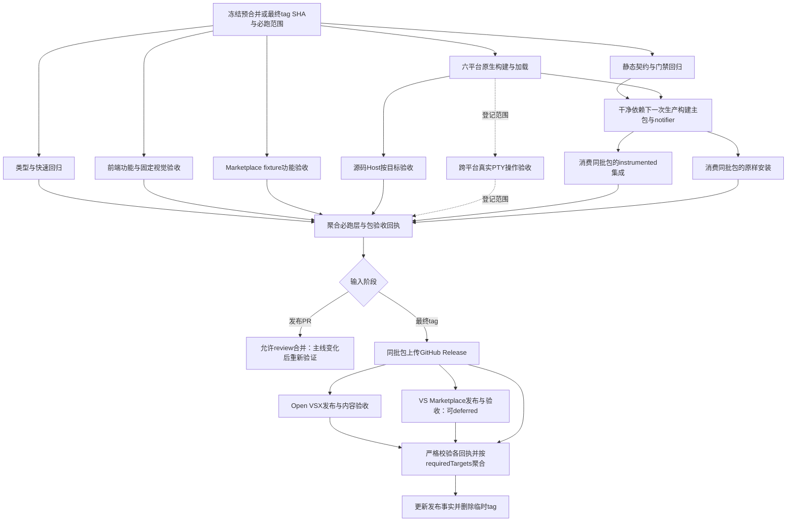

# 发布门禁分层与产物证据审查

## 范围与结论状态

用户要求检查 smoke 之外是否也有不合理的门禁环节。本轮覆盖普通 PR、发布 PR、静态契约、npm 回归、六平台原生资产、Webview、clean checkout、packaged 验证以及渠道发布和 finalize。建议重划验证层和产物交接；一些确定的校验、接线和取证缺口可以先局部修复，不需要等待整个 CI 重构。

本文是可审阅的设计建议，未实施 workflow、产品、测试或仓库设置改动。`validation_status: 未验证` 指推荐方案没有运行验收；源码事实检查和隔离纯逻辑核对已完成，不构成产品、完整门禁或发布成功证据。已有恢复竞态和 PR327 的最终完整门禁仍按原计划闭环，本轮不自动增加 0.26.1 发布契约范围。

输入为修复分支 `0100abf07a6bb09ef36a12b32d989ad0c7e759aa`，fetch 后主线为 `6e708c6b93ce4b2b343729c422f59099f4fb42ba`。固定的25份输入中只有根 `package.json` 与源码 smoke runner 不同于主线：前者多两项回归，后者显式传测试模式；发布 workflow、打包和发布脚本相同。[inputs.json](../references/release-gate-flow-audit/layering-review/inputs.json) 保存 SHA、文件摘要及带时间的 GitHub 只读观察。

现有逐 job 流程继续见[原审查](release-gate-flow-audit.md)与[两组 CI 明细](../references/release-gate-flow-audit/job-details.md)。smoke 场景设计见[场景与子场景重划](smoke-scenario-boundaries.md)。以下流程图描述推荐边界，不替换已有现状图。

## 各环节的审查判断

表中的优先级表示改进顺序。P1 是可能削弱门禁范围或完成判定的确定缺口，P2 是覆盖、隔离和可观测性改进；两者均不自动成为本版新的发布卡点。

| 环节 | 当前实际责任与问题 | 建议与性质 | 优先级 |
| --- | --- | --- | --- |
| 普通 PR 与发布 PR | 非草稿 PR 有稳定的契约检查；无契约变动则实际 verify/native 跳过。没有通用普通 PR 功能回归接线；当前 main API 查询无有效保护 | 重划普通 PR 基础回归与发布产物验收，明确各自范围及聚合 check；保护设置单独配置 | P1 |
| 静态契约与 npm 链 | 静态检查也等六平台资产全部完成；npm test 将70条顶层命令及嵌套 Host、浏览器和 build 串联，首败让后面整层没有结果 | 按真实依赖拆验证层，让静态检查更早执行，独立层独立报告 | P2 |
| 原生资产 | 六实际架构验证摘要、ABI、文件和 require/导出，明确没有调用执行 API；不能代证六平台 PTY 行为 | 保留资产层，另定义有限跨平台操作验收及独立真实 provider 验收 | P2，新增范围待确认 |
| clean checkout 与最终包 | clean checkout 先打主包，packaged runner 再打主包，正式 prepare 又打主包/notifier；测试包摘要没有关联最终发布包 | 重划为一次明确双包构建、消费式验收、发布同一批文件 | P1，证据链缺口 |
| packaged 与原样安装 | 主 payload 被改 manifest/main 后以 development Host 测试，notifier 来自源码 dist；没有在标准 release 链内证明原样双 VSIX clean install | 保留可取证的 packaged integration，另补原样安装层，提前验证 notifier | P2 |
| Webview 功能、视觉与环境 | 同用例混合 ready/内容与截图；固定 CJK 字体和 Ubuntu22.04 仍有必要。stable、Node patch、浏览器缓存路径存在环境边界 | 区分前端功能与固定环境视觉报告；记录环境身份，统一显式浏览器缓存 | P2 |
| 期限、工件与完整范围 | 90分钟大 job、普通 Host 无整场期限；preflight/prepare 失败缺完整 always 上传；filter 可缩减完整验证 | 先局部补范围守卫、阶段期限及有界取证，再配合分层 | P1（范围），P2（取证） |
| 渠道与 finalize | 渠道状态汇总缺 schema/ref/版本/摘要边界检查；历史 verified 忽略本轮查询失败；metadata 可见未证明远端内容匹配 | 抽取共享完成判定，区分提交、可见、内容匹配及历史证据复用 | P1 |

## 1. 普通 PR 回归与发布验收应该分开

`.github/workflows/release-preflight.yml:40` 以 `docs/release-contracts/vX.Y.Z.md` 的 diff 判定发布 PR；无契约时 native 与实际 verify 跳过，稳定的 `Verify release contract` 只证明输入解析成功。这种成功跳过适合作为“无需发布验收”的结果，不能表达普通功能回归已通过。其他 runtime workflow 是手动或特定主题分支触发，不等于一般 PR 的自动基础门禁。

2026-10-17T11:40:50Z 的 GitHub API 仍返回 main `Branch not protected`、rulesets 空数组和有效 branch rules 空数组。文档规定不能替代远端强制检查。仅将现有 preflight 名称设为 required 也不会让普通 PR 自动获得功能验证。

推荐普通 PR 至少运行明确登记的类型/协议/状态回归和相关功能层；发布 PR 再加全范围产物验收。二者都以预合并 SHA 运行，稳定聚合结果必须说明必跑层、已跑、失败、未运行与允许跳过。版本变更与发布契约分类不一致应拒绝含糊跳过，具体分类规则待实施时定义。管理员配置 required check 及最新基准要求后，应以红灯 PR、普通 PR 和过时基准 PR 验证实际阻断；本轮没有修改设置。

## 2. 从串行命令链改为按依赖分层

`scripts/release/release-preflight.mjs:237` 先做静态验证与两项门禁回归，再调用 npm test 和 clean checkout。但 workflow 的 verify job 本身先等六平台资产完成，再安装依赖和浏览器，静态输入错误因此也需要走过资产前置。

当前 npm test 有70条顶层命令，主线68条。第三条 `test:marketplace` 已包含 fixture 浏览器/VSCode E2E；包清单回归再次 build，主 smoke 在第69条，Webview 第70条。这里有真正的单元回归，也有 bundle、原进程与宿主验证，不能仅按脚本名机械分类。早期 Host 失败让后面的快速回归、视觉和产物验收均未运行，也会增加一次只看到一个卡点的概率；本轮未测量总耗时，不能据此给加速百分比。

推荐将静态输入、快速回归、前端交互、视觉基线、Marketplace fixture E2E、源码 Host 和产物验收分为有独立结果的层。层之间只保留真实的产物/前置依赖；需要原生资产的 production build 和 Host 仍等资产，不应在同一 dist 目录盲目并行构建。独立层可以继续产生结果，但任一必跑层失败仍使聚合门禁失败；单场景内部失败后不得继续消费无效状态。`npm test` 可以保留本地全量入口，CI 不必依赖同一条长 shell 链表达全部责任。

[静态可达性报告](../references/release-gate-flow-audit/layering-review/verification.json)还列出未由根 npm run 链调用的 notifier 独立检查、publish-tag 回归、runner-env、root ownership/preparation、startup-profile/namespace 和 execution-native-assets。部分脚本在独立 workflow 或其他代码测试中已有覆盖；此清单不是“完全未测试”的结论。实施时应给重要检查登记所属层和触发方式，避免只因历史接线遗漏而不进入标准链，也避免不加判断地把所有具名脚本塞回 npm test。

## 3. 六平台资产与六平台行为需要不同结果

`.github/workflows/runtime-execution-assets.yml` 的六 runner、`fail-fast: false`、固定目标 Node、minimum Node/Electron load 和兼容性检查有明确价值。`scripts/build/check-execution-native-load.cjs:7` 核对平台/架构、Node/N-API、文件摘要，加载二进制并验证导出的函数类型；输出明确为 `nativeLoaded=true`、`executionApiCalled=false`、`productValidated=false`。minimum Node 加载也不能代证最低支持 VSCode 的产品行为。

`scripts/build/assemble-execution-distribution-assets.mjs:11` 要求完整 SHA、六目标、archive 摘要、固定 regular 文件集合、禁止覆盖和 staging 原子提交。这些保证应全部保留，不能为了缩短 CI 改成下载未证明来源的既有资产。

推荐在分发资产 load 之外定义有限的执行操作验收：使用当前目标资产启动真实 shell/PTY，检查输入输出、resize 的可观察结果、自然退出、用户 Stop 与资源清理。六平台应明确哪一层自动接线、何时必跑、哪些能力不适用。无需把六平台×所有 smoke×真实 Agent provider 变成每个 PR 的笛卡尔积；真实 TUI、网络与凭据依赖继续有独立 provider 验收入口，并绑定源码/包与 provider 版本。本轮不声明这些新增用例已实现，也不将 Linux 主门禁通过称为六平台产品通过。

## 4. 测试最终要消费将发布的那一批 VSIX

当前构建路径存在确定的证据断点：

1. `scripts/release/run-clean-checkout-vsix-validation.mjs:65` 打主 VSIX，并按 mtime 选出根目录最新包。
2. 它调用 `test:vsix-smoke`；`scripts/smoke/run-vscode-vsix-smoke.mjs:42` 又 build notifier、打主 VSIX，再按 mtime 选择主包做测试。
3. tag prepare 先完整 verify，随后 `.github/workflows/publish-marketplace-release.yml:230` 调用 `release:publish-tag --package-only`，正式重新生成主包和 notifier 包。
4. 正式 manifest 记录最终包摘要和源码 ref，但没有对应 clean/packaged 测试包的摘要或内容等价证明。

这不证明重打的包实际不同，证明的是“验过的文件”没有绑定到“发出的文件”。mtime 也不适合作为跨阶段选择测试对象的契约。

推荐每个验证输入在干净源码和依赖下明确生成主包与 notifier 包一次，输出固定路径、扩展身份、版本、完整源码 SHA、原生资产集合摘要、VSIX 摘要及验证回执。packaged runner 接受这些包路径并仅消费，不在内部重打。之后原样安装也消费同一批包；发布步骤上传、提交该批包，修改任一文件使回执失效。instrumented Host 对 payload 的修改必须记为测试副本，不改原包。

PR 预合并与最终 main tag 是不同 SHA，其 README ref 和合并输入本来就可能不同。**两阶段完整验证仍需保留**，不能直接将 PR 候选包用于正式发布，也不能以 tree hash 代替最终 ref 复验。推荐是每个阶段内部一次构建并验证自己的包，最终 tag 阶段验完后发布自己的同批文件。

已有 GitHub Release 的重跑继续取回原主包/notifier/manifest、核 ref/版本/包摘要并复用，不重打覆盖不完整 Release。这条幂等保护已经存在，应保留；为旧包补做验收时同样消费原包，不能用新打包的通过结果代证它。

## 5. packaged integration 与原样安装分两层

`run-vscode-vsix-smoke.mjs:84` 解出主扩展 payload，删除 staged manifest 的 `extensionDependencies`/`extensionPack`，将 main 改为 wrapper，注入 suite，以 development Host 运行八场景。notifier 从源码 package/dist/images stage，并非消费正式 notifier VSIX。测试模式还影响诊断和运行时准入，因此它是一层有效的“打包 payload 集成验证”，但不是原样 Marketplace 安装验收。

推荐保留此层用于细粒度观察、真实 PTY 和原功能链验证；另在空 extensionsDir 中原样安装两只 VSIX，由独立测试驱动检查 manifest 依赖、activation、主/notifier 路由、回跳、locale 和基本执行。被测包保持正式 main/依赖声明，明确驱动和产品测试模式的边界。安装本地双包仍不能代证 Marketplace 自动下载 companion，联网依赖安装应有单独说明。

根 typecheck 当前只覆盖主扩展。标准链已有 notifier 源码测试和 esbuild，但独立 typecheck、回跳/locale smoke 未由根 test 接线；正式 notifier 打包才执行自己的 typecheck。推荐将 notifier 类型及双包构建提前到发布 PR，给回跳/locale安排适当的源码或原样安装层，使这类错误在准备发布前暴露。独立 production acceptance workflow 可作为实现输入，但它目前不是 release workflow 的 required dependency，不能据其存在宣称标准链已经覆盖。

## 6. 功能、视觉、环境和缓存要有清楚边界

`tests/playwright/webview-harness.spec.mjs:281` 在同一用例验证 ready/内容与截图。`playwright.config.mjs` 已有30秒用例期限、5秒 expect、失败 trace/截图，但混合结果不利于区分协议失败和字体/渲染差异。推荐将前端交互/协议与固定环境视觉基线独立报告，保留现有覆盖和严格像素断言。

既有 CJK 字体子集和 Ubuntu22.04 是已验的截图稳定措施，应保留，不通过换 baseline 或放宽像素预算解决环境问题。稳定验收线记录 VSCode、Node patch、Playwright/Chromium revision、系统镜像版本、字体、locale 和显示尺寸；可以另设 latest 观察线发现上游变化，但其结果不冒充固定输入的成功。最低 VSCode 支持范围另行定义验收，minimum Node load 不能替代它。

workflow 预先安装 Chromium，`scripts/shared/playwright-environment.mjs:7` 又固定缓存到当前 projectRoot，`run-playwright-webview.mjs:5` 每次执行 install。clean checkout 虽继承 `PLAYWRIGHT_BROWSERS_PATH`，该 helper 会改为自己的缓存目录，可能另取浏览器。推荐统一明确的缓存路径和锁定 revision，记录下载/使用身份；依赖和浏览器缓存可以复用，发布包与可变运行目录不能因此共享。当前没有耗时样本，不能认定重复下载就是历次超时根因。

## 7. 范围、期限和失败取证先做局部补齐

既有审查已证明 `release:verify` 会继承 smoke filter，源码19/packaged8能缩为1/1；完整模式需要拒绝或清理筛选、冻结必跑集合并核对实际执行结果。未知/空集合和缺少必跑层应失败，定向模式必须有独立名称与报告。该守卫不必等场景迁移完成。

preflight 与 prepare 的90分钟 job 期限不能代替下载、安装、准备、业务完成、Host 退出和清理各自的等待。普通 VSCode runner 没有整场 Host 期限；需要分阶段 deadline、整场上限和有界失败取证。用户 Stop 完成、运行时退役与测试 Host 退出的对象边界继续按 smoke 设计处理，不能统一用进程 kill 代表业务完成。

preflight/prepare 失败会有本地日志和保留 clean 临时目录，但 workflow 没有完整 always 工件上传。推荐每层产生固定输入、case/步骤、实际结果、首败、未运行项、业务与清理结果；失败有界保存诊断、Host 输出、环境版本、trace、包及资产摘要并 always 上传。native 与 channel/finalize 已有的失败上传保留。传输错误可有界重试；业务等待和整场测试不默认自动重跑，提交结果未知时先查询同一版本/包，不盲目重发。

## 8. 发布完成必须校验渠道证据的身份

当前渠道并行及部分成功后可重跑是合理设计。VS Marketplace deferred 的既定策略是 GitHub assets+Open VSX 完成即可结束，VS 渠道另记录状态；本轮不改变该策略。发布外部副作用无法通过换 job 顺序得到真正原子性，应保留幂等状态及临时 tag 恢复入口。

但 `.github/workflows/publish-marketplace-release.yml:528` 的 inline finalize 直接复制 partial 的 `marketplaces[key]`，没有校验 partial schema、version、releaseRef、artifact 摘要和目标范围。它只按两只扩展的 `verified/already-published` 状态判完成，不结合本轮渠道 job 结果或独立验收回执；缺少 partial 时保留 base 的历史状态。GitHub assets 也根据 prepare 成功写 `assets-uploaded`，并非 finalize 重新校验远端内容。

[隔离核对](../references/release-gate-flow-audit/layering-review/verification.json)直接提取现有 inline Node 逻辑，以临时 JSON 运行：匹配 partial 正常完成；错 releaseRef、错 artifact hash 也完成；缺 partial 但 base 有历史 verified 仍完成；缺 partial 且无历史状态失败。这些反例证明合并边界缺校验，不证明同 run 的实际 artifact 曾被混用。前面的 ref/包摘要 guard 与同 run 下载已降低错输入概率，不能把边界反例写成历史错误发布。

`scripts/release/publish-tag-release.mjs:436` 还先查询远端，再在 previousStatus 为 verified 时直接 continue；隔离 query=false 仍返回验证成功，而 pending+false 返回失败。该实现可复用历史成功，但目前状态没有清楚表达“历史验收复用”和“本轮查询失败”的区别。`openVsxVersionExists:502` 只检查版本及下载/图标/license/sha256/manifest链接存在，VS 查询只检查版本列表；远端同版本存在不等于与本地包内容一致。

推荐抽取本地和 workflow 共用的完成判定模块，验收回执绑定 schema、完整 ref、版本、扩展 ID、artifact 摘要、目标、run/attempt、证据时间和来源。将“发布请求已提交”“版本可见”“metadata 完整”“内容匹配”“验收完成”区分记录。缺失、错身份、重复/冲突结果不得仅按字符串成功；历史证据允许按明确策略复用，但必须匹配原包并保留来源，本轮失败/未知单独呈现。必需渠道失败或缺工件不能只凭历史 status 放行；若允许复用，要有独立且匹配身份的成功回执。

远端内容核对方式仍需受控验证：Open VSX 的 sha256 链接语义、Marketplace 重签是否改变 ZIP bytes、可比较的 payload/manifest范围，都没有在本轮确定。不能无条件要求重签后的整包摘要等于上传前摘要，也不能因此只检查同版本存在。应先选定各渠道支持的内容身份口径。GitHub Release assets 可以直接绑定原文件摘要；finalize 应使用可信上传/复核回执，按既定 requiredTargets 聚合后才删临时 tag。

现有 `test-publish-marketplace-workflow.mjs:237` 主要用字符串/结构断言检查 inline merge，未执行错身份的反例。推荐测试共享判定模块的正例、错版本/ref/hash/schema/目标、缺结果、历史复用、当前失败和 deferred 组合；再用无发布副作用的 workflow fixture 检查接线，真实渠道验收另外提供证据。

## 推荐的依赖关系

下图以发布 PR/最终 tag 的完整模式为例。每层内部仍有准备、动作、断言、清理；独立 job 使用独立目录，同一输入及同批原生资产可按需传递。虚线处表示后续范围要明确登记，不能按图直接宣称已经必跑。

Marketplace fixture 或前端层若调用 production build，实施时应增加真实的原生资产依赖，或显式选用只满足该层目的的隔离构建；图中不能被解释成绕过正式资产准入。普通 PR 使用其中明确选定的基础层，发布 PR 和最终 tag 使用各自完整冻结范围。渠道重跑消费原包/回执，不执行新的包覆盖。

## 候选方案与推进顺序

仅延长总 job 时间、增加整场重试无法补包身份和范围证明，还可能隐藏业务失败。仅将长链拆 job 可以改善反馈，但若每 job 都重打包或采用历史状态，证据断点仍在。推荐先补局部守卫与回执，再按实际依赖拆层。

第一批处理完整范围守卫、finalize 输入校验/历史复用口径、阶段 deadline 和失败 always 工件；把已有必需的 notifier 检查及门禁自身行为回归登记接线。这些改动有明确反例，可逐项验证，并继续当前关联修复 PR 范围。

第二批重划干净双包构建、消费式 packaged/原样安装以及最终包回执，让最终 tag 发布测试过的同批文件。同时给普通 PR 与发布验收独立、稳定的聚合结果。branch protection 是必要配置动作，不能由文档替代。

第三批按真实依赖拆快速、前端、视觉、Marketplace 和源码 Host，记录耗时后再优化缓存和并发；选定有限跨平台操作、最低 VSCode 和 latest/provider观察范围。这些新增覆盖不自动升级为 0.26.1 发布阻塞，应另确认目标和成本。

验收应逐层验证错 SHA/错包/缺必跑层必须失败，业务与清理失败均有现场，最终上传摘要等于消费式验收输入；跨平台操作和原样安装须在真实 runner/Host 证明。旧覆盖在迁移映射与等价验收完成前保持。两次 release ref 完整验证、六目标来源核验、已有 Release 禁止重打覆盖及渠道 deferred/恢复策略均保留。

## 本轮验证与限制

在仓库根运行 `python3 docs/references/release-gate-flow-audit/layering-review/verify.py`：25输入摘要核对、70条顶层命令与具名 script 可达性、5项现有 finalize 纯逻辑案例、3项历史 verified/query 案例通过核对。临时目录自动删除；查询被 stub，不读凭据、不用网络、不执行 gh/tag/package/publish。此“通过”是确认现有行为符合审查事实，并非缺口已修复。

本轮未安装依赖，未运行产品、六平台 CI、原样安装、完整 release:verify 或真实渠道内容核对；未修改仓库保护、PR、tag、版本和发布材料。证据目录说明及复现命令见[layering-review/README.md](../references/release-gate-flow-audit/layering-review/README.md)。
