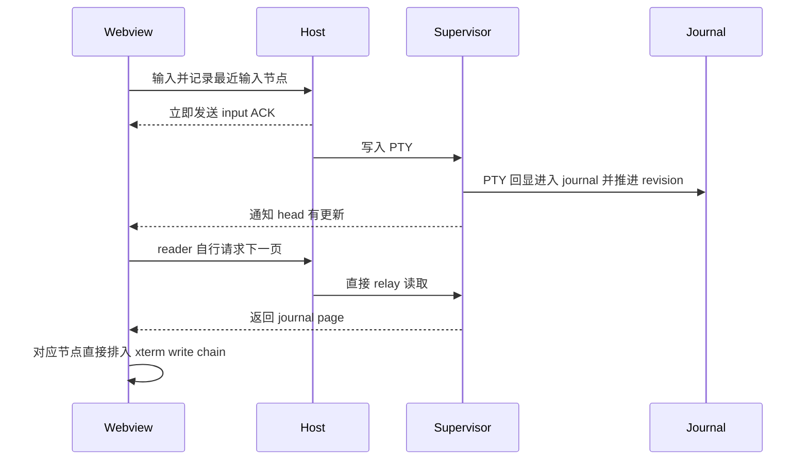

# Runtime journal 分页的输入优先调度

## 1. 背景

RuntimePersistence 的 `terminalPagedReadV1` 用 Supervisor 的 xterm 模型和 journal 恢复、更新 Webview 内的终端。输入仍从 Webview 进入 Host，再写给原 PTY；PTY 回显由 Supervisor 写入 headless xterm 和 journal，Webview 随后按 revision 拉取页面。输入没有本地乐观回显，显示内容仍以真实终端输出为准。

仓库已有一个跨节点交互规则：最近输入的 `kind + nodeId` 获得短时输出优先级，后台节点仍须在有界时间内推进。普通 `host/executionOutput` 路径已接入 Host 和 Webview 输出调度，但当前 journal page 路径没有贯通这条优先级。

本提案基于 2026-10-25 获取的 `origin/main@37ff8554` 源码。它确认了调度路径的差异，不证明这个差异就是某一次用户卡顿的唯一原因；回显端到端时间仍须从真实诊断取得。

## 2. 问题定义

输入派发时，`webview/main.tsx` 的 `reportExecutionInputDispatch()` 记录最近输入节点；Host 收到 `webview/executionInput` 时也记录 `recentExecutionInputPriority`，并立即发送输入 ACK。普通 Host 输出由 `CanvasPanelManager` 的 `selectScheduledExecutionOutputPosts()` 选择最近输入节点；普通 Webview 输出由 `selectExecutionTerminalDrainEntries()` 在 controller 间选择节点。

启用 journal 分页后，路径不同：

1. `webview/terminalPagedProjection.ts` 中的 `TerminalPagedProjection.pull()` 在自身 reader 有新 head 且上一页已应用后，直接发起下一次 page request。每个 reader 一次只有一个页面请求或应用中的页面。
2. `CanvasPanelManager.readExecutionTerminalPage()` 直接调用 `RuntimeTerminalReadRelay.read()` 并向 Webview 返回页面。该路径不经过普通 `host/executionOutput` scheduler。
3. Webview 收到页面后，`main.tsx` 的分页 `events` 回调直接进入该节点的 `queueTerminalWrite()` 和 `applyTerminalStreamEvents()`。页面输出没有进入普通 controller output drain 的 `selectExecutionTerminalDrainEntries()`。

因此，现有规则保证了**一个 reader 内部的顺序、重试游标和应用回执**，但没有在多个 journal reader 之间按最近输入节点选择 page read，也没有在多个节点的 journal page 写入之间按最近输入节点仲裁。每 reader 单页背压不等于跨 reader 优先级。

## 3. 目标

- 最近接收用户输入的 Agent / Terminal 节点，其真实 journal 回显在页面读取和 xterm 应用阶段优先推进。
- 保持同一 reader 的 `authorityId + revision` 连续、事件顺序、幂等重试与“应用后才 ACK”语义，不丢弃或重排任何节点内容。
- 在持续输入下为其他节点提供有界公平服务；队列和在途页面的资源上界应明确，不能以无限推迟或清除后台页面换取响应。
- 能从诊断中区分输入节点优先是否缩短 page 请求等待、页面回传等待和 xterm 应用等待。

## 4. 非目标

- 不改变 Supervisor journal 格式、checkpoint 资格、revision 语义、压缩回收或 RuntimePersistence 的启用策略。
- 不改变输入 RPC、输入 ACK、PTY 写入顺序，也不添加本地 echo。
- 不重构非分页旧 Supervisor 或 `snapshot-only` 输出链路。
- 不因 Webview 不可见、输出过多或读者落后而丢弃 journal 事件、改用不连续快照或伪造已应用 revision。
- 不把最近输入等同于永久焦点状态；本提案沿用 `kind + nodeId` 的最近输入身份。

## 5. 候选方案

### 5.1 只给页面应用排序

页面照常由各 reader 并行请求。Host 返回页面后，Webview 把页面放入一个共享应用队列，优先应用最近输入节点的页面。

优点是改动集中在 Webview，可以直接保护 xterm 的应用顺序。缺点是低优先级页面仍可同时通过 Host→Webview 消息桥；并行读取及消息反序列化竞争没有被调度，优先节点的 page request 也可能等待其他 reader 的读取工作。它只修复链路末端。

### 5.2 只在 Host 对 page read 排队

Host 收到多个 `readExecutionTerminalPage` 后，用最近输入节点选择要调用的 Supervisor reader，再按选择顺序返回页面。

优点是可复用 Host 已有的最近输入状态，并能减少同时进入 Supervisor/消息桥的读取请求。缺点是页面抵达 Webview 后仍由各 controller 直接排入 xterm write chain，后台大页仍可能先进入 xterm parser 队列；只调请求不能保证当前节点先应用。

### 5.3 Webview 共享分页调度器（推荐，待确认）

每个 `TerminalPagedProjection` 仍拥有自己的 authority、revision、重试及 applied 状态，但将“需要读页”和“收到页面待应用”交给 Webview 共享调度器。调度器在发出 page read 前选择 reader，在页面返回后再次选择可应用的页面。`CanvasPanelManager` 和 `RuntimeTerminalReadRelay` 保持当前透明转发，不增加协议字段。

该方案可在现有 `reportExecutionInputDispatch()` 最近输入标记处取得优先键，并在页面发起和 xterm 应用两个阶段执行同一公平策略。每 reader 仍只允许一页在途；全局并发页上限需要由多 reader 基准选择，不预设为 4 或其他无证据数字。应用时沿用每节点 write chain，把 output 按有界小批次写入，并在批次边界允许调度器切换节点；单节点仍严格保序，只有整页所有事件完成后才推进 applied revision 并允许读下一页。

### 5.4 Host 与 Webview 各放一套独立 page scheduler

Host 调度读取，Webview 再单独调度应用。

该方案控制点最全面，但增加两套队列、两处公平状态和取消/迟到页面协调。若 Webview 统一调度器已控制读取发起与应用，目前没有证据表明 Host 再复制一套调度器有额外收益，因此不作为首选；若验证发现 Host event loop 或消息投递仍是瓶颈，再重新评估。

## 6. 风险与取舍

共享调度器需要处理页面响应晚于 reader 替换、输入优先级在读取期间变化、某节点 xterm write 失败，以及同一页含大量 output 和 resize/scrollback 边界等情况。旧 `readId`、Webview generation 或 session 的页面必须按现有身份校验丢弃，不能 ACK；失败重试必须从同一 `afterRevision` 重来。

调度只能重新排序**不同节点**的执行时机，不能改变同节点 revision 顺序。后台公平必须以页面请求排队时间计算，而不能因 reader 持续产生新 head 而重置年龄。任何全局 in-flight 上限都要计入每页 256 KiB 预算及单个大 event 可超过该预算的既有例外；不能把 page budget 误称为严格内存上界。

最近输入优先窗口当前在 Webview 为 240ms，在 Host 普通输出调度为 300ms；Webview 普通 drain 对后台项的等待上限为 480ms。推荐先复用 Webview 的最近输入标记和 240ms / 480ms 行为，避免这项改动顺便重新定义输入语义。该时间窗口能否覆盖真实输入到 journal page 应用的延迟尚未验证；若诊断显示回显常在窗口之后到达，应在实现前单独确认优先级保留期限。

## 7. 当前结论

**推荐方案 5.3，尚未被接受为正式方案。** 设计方向是在 Webview 增加一个共享的 journal page demand/application 调度器：输入节点优先发起 page read，也优先取得页面应用机会；后台 reader 按排队年龄得到有界服务；reader 内 revision 保序和整页应用后 ACK 不变。其余候选要么只覆盖传输/应用一端，要么在 Host 与 Webview 重复建立调度状态。

以下参数与验收假设须在实现前确认或用具名基准决定：

- 多 reader 同时活跃时全局允许多少个 page read 在途。建议先测量串行读取及小并发读取的输入回显延迟和后台完成时间，再选取最小有效上限。
- 是否沿用 240ms 输入优先窗口和 480ms 后台公平上限。它们是当前 Webview 普通 drain 的参数，不是 RuntimePersistence 页路径已验证的 SLA。
- page application 的有界写批次是否能复用现有 64 KiB 输出批次边界，还是应采用更小的输入期预算。

开始编码前，用户需要确认：采用方案 5.3 作为设计方向，且接受上述参数通过定向验证后再冻结。此确认前不改运行时代码、不宣称现有延迟已归因于此缺口。

## 8. 验证方法

实现后先用 Webview 调度器单测注入多个有持续页面需求的 reader：新近输入节点的 read request 和 page application 都先得到服务；同 reader 的 revision 不跳号、不重复；持续输入期间后台 reader 超过等待上限后仍推进；替换 reader、页面迟到、xterm 写失败和重试均不错误 ACK；全局在途页数不超过选定上限。

随后在具有多 Agent / Terminal 持续输出的真实 Webview 场景同时输入一个节点，记录同一 input sequence 对应的输入 ACK、page requested、page received、`paged-events` write 开始/完成与 applied revision。验收应看到当前输入节点的 page 请求及真实回显优先，同时逐节点核对完整、无重复、无乱序输出，并报告后台最大等待和全局在途页面峰值。需明确诊断仍不能把优先调度单独证明为唯一卡顿根因；端到端对照还须排除输入 RPC / PTY 写入延迟。
