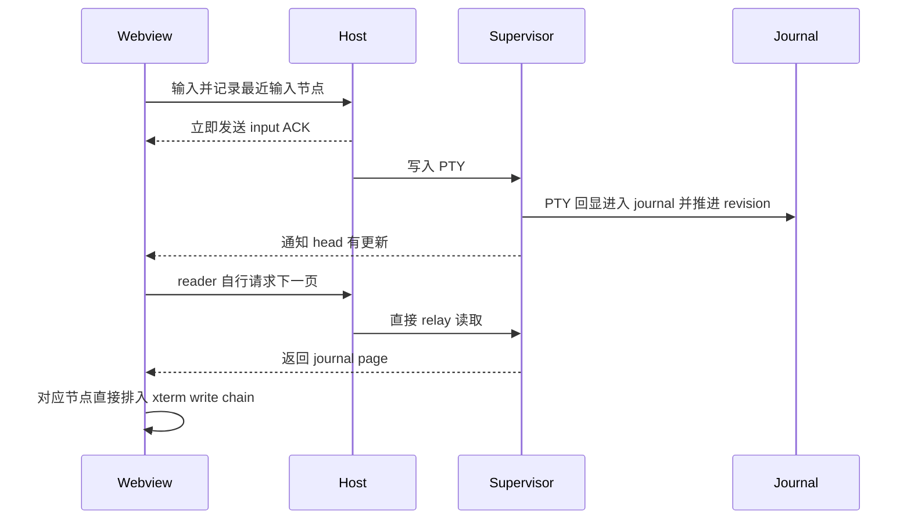
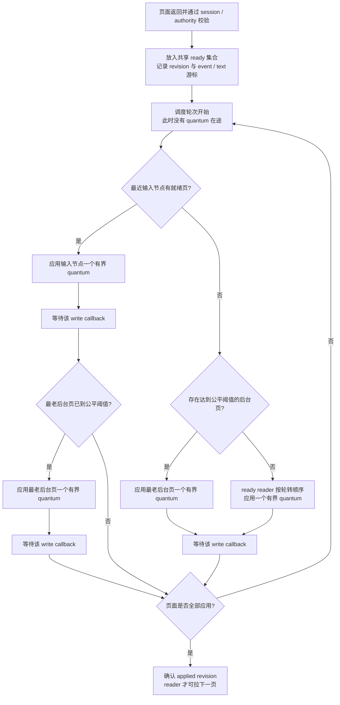

# Runtime journal 分页的输入优先调度

## 1. 背景

RuntimePersistence 的 `terminalPagedReadV1` 用 Supervisor 的 xterm 模型和 journal 恢复、更新 Webview 内的终端。输入仍从 Webview 进入 Host，再写给原 PTY；PTY 回显由 Supervisor 写入 headless xterm 和 journal，Webview 随后按 revision 拉取页面。输入没有本地乐观回显，显示内容仍以真实终端输出为准。

仓库已有一个跨节点交互规则：最近输入的 `kind + nodeId` 获得短时输出优先级，后台节点仍须在有界时间内推进。普通 `host/executionOutput` 路径已接入 Host 和 Webview 输出调度，但当前 journal page 路径没有贯通这条优先级。

本提案基于 2026-10-25 获取的 `origin/main@37ff8554` 源码。它确认了调度路径的差异，不证明这个差异就是某一次用户卡顿的唯一原因；回显端到端时间仍须从真实诊断取得。

## 2. 问题定义

输入派发时，`webview/main.tsx` 的 `reportExecutionInputDispatch()` 记录最近输入节点；Host 收到 `webview/executionInput` 时也记录 `recentExecutionInputPriority`，并立即发送输入 ACK。普通 Host 输出由 `CanvasPanelManager` 的 `selectScheduledExecutionOutputPosts()` 选择最近输入节点；普通 Webview 输出由 `selectExecutionTerminalDrainEntries()` 在 controller 间选择节点。

启用 journal 分页后，路径不同：

1. `webview/terminalPagedProjection.ts` 中的 `TerminalPagedProjection.pull()` 在自身 reader 有新 head 且上一页已应用后，直接发起下一次 page request。每个 reader 一次只有一个页面请求或应用中的页面。
2. `CanvasPanelManager.readExecutionTerminalPage()` 直接调用 `RuntimeTerminalReadRelay.read()` 并向 Webview 返回页面。该路径不经过普通 `host/executionOutput` scheduler。
3. Webview 收到页面后，`main.tsx` 的分页 `events` 回调直接进入该节点的 `queueTerminalWrite()` 和 `applyTerminalStreamEvents()`。页面输出没有进入普通 controller output drain 的 `selectExecutionTerminalDrainEntries()`。

因此，现有规则保证了**一个 reader 内部的顺序、重试游标和应用回执**，但没有在多个 journal reader 之间按最近输入节点仲裁页面应用。需要区分：目前 page read 是按 session 独立发起的异步请求，没有发现所有 session 共享一个按先来先服务的 RPC 队列；“没有 read scheduler”本身不能证明输入节点的 read 会排在其它节点后面。明确缺失的调度点是多个页面进入同一个 Webview/xterm 主线程时，谁先得到应用机会。

## 3. 目标

- 最近接收用户输入的 Agent / Terminal 节点，其已返回 journal 页面优先进入 xterm 应用；其 page read 仍保持现有按 reader 按需发起。
- 保持同一 reader 的 `authorityId + revision` 连续、事件顺序、幂等重试与“应用后才 ACK”语义，不丢弃或重排任何节点内容。
- 在持续输入下为其他节点提供有界公平服务；队列和在途页面的资源上界应明确，不能以无限推迟或清除后台页面换取响应。
- 能从诊断中区分输入回显等待发生在 page 请求、Host/IPC 返回还是 xterm 应用阶段；只有发现共享读取队列后才把 read admission 纳入调度。

## 4. 非目标

- 不改变 Supervisor journal 格式、checkpoint 资格、revision 语义、压缩回收或 RuntimePersistence 的启用策略。
- 不改变输入 RPC、输入 ACK、PTY 写入顺序，也不添加本地 echo。
- 不重构非分页旧 Supervisor 或 `snapshot-only` 输出链路。
- 不因 Webview 不可见、输出过多或读者落后而丢弃 journal 事件、改用不连续快照或伪造已应用 revision。
- 不把最近输入等同于永久焦点状态；本提案沿用 `kind + nodeId` 的最近输入身份。
- 不在没有读阶段排队证据时，为独立 session 的 page RPC 引入一个全局串行队列或任意并发上限。

## 5. 候选方案

### 5.1 Webview 共享页面应用调度器，读取仍按 reader 按需进行（推荐）

各 reader 保留现有方式：有新 head、且自身没有未完成页面时，立即从自己的 `afterRevision` 请求一页；不新建跨 session 的全局读队列。页面返回并校验身份后，Webview 不再把整页直接排进该 controller 的 write chain，而交给一个共享 page application scheduler。这里的优先级作用在**已返回页面的应用**，不作用在 page read RPC；若输入节点的页面还没读回来，调度器不能凭空让它先显示。

调度器为每个待应用页面保存 `(authorityId, revision)`、event 游标和当前 output event 的 UTF-16 字符偏移。每一轮只派发一个有界 xterm write quantum，等待对应 xterm write callback 后再重新选 reader。若当前用户最近输入节点有就绪页面，它先拿一个 quantum；若最老后台页面已达到公平等待阈值，则同一轮额外给该后台页面一个 quantum，并在下个选择点重新按等待年龄挑选后台 reader。否则输入优先窗口内暂缓未超时后台页面；窗口外按 ready reader 轮转。输出文本可在 quantum 边界切片，resize / scrollback 等结构事件不可越过之前未写完的文本，也不可相互重排。只有该页全部事件应用成功后，才向原 reader 调用 `applied`，推进 revision 并允许它拉下一页。

建议把现有普通 Webview drain 作为**起始基线**而非已验证值：输入窗口沿用 240ms；输入节点每次最多写入 4 Ki 个 JavaScript UTF-16 code unit；后台等待达到 480ms 后额外获得最多 4 Ki code unit；常规量子先以每 controller 最多 16 Ki code unit 为起点。现有 drain 的普通总预算是每轮最多 32 Ki 字符；是否在共享 page scheduler 中也需要等价总预算，由定向负载验证决定。分页协议的 64 KiB 页预算不是应用 quantum，不能直接拿来当一段不可让出的 `terminal.write()` 大块。480ms 是启动后台服务的年龄阈值，不是 xterm callback 的完成 SLA。所有参数仍待确认，并须通过输入回显与后台完整排空的同负载对照验证。

候选调度轮次如下：

优点是将优先级放在确有共享竞争的 Webview/xterm 应用边界，同时保留每 session 独立异步读取。限制是已经开始的单个 xterm write 不能抢占；页面消息跨 Webview bridge 的反序列化也没有优先级。每 reader 仍可能持有一页已读未应用的正文，因此总内存按活跃 reader 数增长，不能宣称全局固定上限。

### 5.2 只在 Host 对 page read 排队

Host 收到多个 `readExecutionTerminalPage` 后，用最近输入节点选择要调用的 Supervisor reader，再按选择顺序返回页面。

优点是可复用 Host 已有的最近输入状态，并能减少同时进入 Supervisor/消息桥的读取请求。缺点是页面抵达 Webview 后仍由各 controller 直接排入 xterm write chain，后台大页仍可能先进入 xterm parser 队列；只调请求不能保证当前节点先应用。

### 5.3 Webview 同时调度 page demand 和应用

每个 `TerminalPagedProjection` 将“需要读页”和“收到页面待应用”都交给 Webview 共享调度器；有全局读取并发上限时，调度器才会在发出 page read 前选择 reader。实现还须决定 interactive reader 是否有保留读取名额，否则在途背景读占满全部名额时，当前输入节点仍要等一个读取结束。`CanvasPanelManager` 和 `RuntimeTerminalReadRelay` 可以继续透明转发，不增加协议字段。

该方案可在页面读取阶段和应用阶段执行统一公平策略，也能在将来控制 Host/IPC 读取压力。但当前各 session 的 page RPC 是分开的异步请求，没有发现它们排入一个共享 FIFO；增加全局读取并发限额或保留槽会改变并发模型并可能增加延迟。没有读阶段排队/Host 消息压力的现场证据前，不先采用它。

### 5.4 Host 与 Webview 各放一套独立 page scheduler

Host 调度读取，Webview 再单独调度应用。

该方案控制点最全面，但增加两套队列、两处公平状态和取消/迟到页面协调。若 Webview 统一调度器已控制读取发起与应用，目前没有证据表明 Host 再复制一套调度器有额外收益，因此不作为首选；若验证发现 Host event loop 或消息投递仍是瓶颈，再重新评估。

## 6. 风险与取舍

共享应用调度器需要处理页面响应晚于 reader 替换、输入优先级在写入期间变化、某节点 xterm write 失败，以及同一页含大量 output 和 resize/scrollback 边界等情况。旧 `readId`、Webview generation 或 session 的页面必须按现有身份校验丢弃，不能 ACK；失败重试必须从同一 `afterRevision` 重来。输入 priority 在 callback 边界重新读取；已开始的 write 保持原样结束，不能中途撤销。每个 quantum 都等 callback 再选择会把跨节点应用串行化，可能降低总吞吐；这正是输入响应与总排空速度之间需要实测的取舍。xterm callback 表示该次 write 已处理，不等于浏览器已经完成绘制，所以端到端指标仍要观测真实画面回显。

调度只能重新排序**不同节点**的执行时机，不能改变同节点 revision 顺序。后台公平年龄应以最近一次应用 quantum 为基准，不能因 reader 收到新 head 或当前输入持续刷新而重置。现状是每个可见 reader 最多有一页在途或待应用；聚合正文随活跃 reader 数增长。单页沿用 256 KiB 事件数组 JSON / 256 条预算，但单个大 event 可超过该字节预算；不能把它误称为严格内存上界。

最近输入优先窗口当前在 Webview 为 240ms，在 Host 普通输出调度为 300ms；Webview 普通 drain 对后台项的等待上限为 480ms。推荐先复用 Webview 的最近输入标记和 240ms / 480ms 行为，避免这项改动顺便重新定义输入语义。该时间窗口能否覆盖真实输入到 journal page 应用的延迟尚未验证；若诊断显示回显常在窗口之后到达，应在实现前单独确认优先级保留期限。

## 7. 当前结论

**推荐方案 5.1，尚未被接受为正式方案。** 读取保持 per-reader 按需并行；Webview 仅增加共享 page application scheduler，在跨节点竞争 xterm main thread 的位置执行最近输入节点优先与后台轮转。端到端诊断分别记录 page request、page returned、xterm quantum 和 applied revision；不要称该算法为“优先读取”，因为它只影响已返回页面的应用次序。候选方案 5.3 只有在诊断证实 Host/Supervisor page read admission 是共享瓶颈时再启动，不能凭“没有同一套 scheduler”就新增全局读取队列。

以下参数与验收假设须在实现前确认或用具名基准决定：

- 是否沿用 240ms 输入优先窗口和 480ms 后台公平阈值。它们是当前 Webview 普通 drain 的参数，不是 RuntimePersistence 页路径已验证的 SLA。
- page application 是否从现有 drain 量级开始：输入/超时后台各 4 Ki UTF-16 code unit、普通 reader 每次最多 16 Ki、普通轮次是否额外限制总计 32 Ki；它们是候选字符数，不是字节，也没有在 journal page 路径验证。
- callback 串行 quantum 会否损害多 terminal 总吞吐，以及是否需要 requestAnimationFrame / drain-turn 总预算来为浏览器绘制留出机会。write callback 只证明 xterm 处理了该 write，不证明像素已绘制。
- 如果诊断显示 read RPC 或 Host→Webview posting 本身形成共享队列，再为后台读取引入全局并发预算；当前并发模型允许不同 session 独立读，不应先选一个任意数字。

开始编码前，用户需要确认：采用方案 5.1 作为第一步，且接受上述批次/时间参数通过定向验证后冻结。此确认前不改运行时代码、不宣称现有延迟已归因于此缺口。

## 8. 成熟依据与复用边界

最直接的依据是仓库已经使用的 `common/executionOutputScheduler.ts`：它按 `kind + nodeId` 提升最近输入节点，并在后台等待达到阈值后释放最老 controller。`scripts/test/test-execution-output-scheduler.mjs` 覆盖 10 个 Agent 的普通 drain 选择：输入节点优先；连续输入时，9 个等待达到 480ms 的后台 controller 逐个得到额外 drain slot。测试证明现有选择函数的规则，不证明 journal 页应用性能。建议复用这个选择原则和诊断，不另造优先级身份模型；journal page 需要补的是共享应用队列和可让出的 xterm write quantum。

### 8.1 可选调度算法

这些都是成熟的队列调度方法，但优化目标不同。对比假设“每个 ready reader 可以被切成有限 xterm write quantum”：

| 算法 | 选择规则 | 优点 | 用于当前终端回显的限制 |
| --- | --- | --- | --- |
| Round Robin（RR） | ready reader 逐个获得一个 quantum | 实现简单；在 callback 最终返回的前提下，每个 ready reader 都能轮到 | 所有节点同等优先，不能直接让刚输入节点更快 |
| Weighted Round Robin（WRR / IWRR） | 按配置权重分配 turn，例如输入队列多轮、后台队列一轮 | 服务份额显式；适合想控制交互与后台吞吐比例 | 权重保证的是轮次/份额，不是回显最大延迟；终端处理成本也不一定与字符数成正比 |
| Strict priority + background reservation | 输入节点先服务，同时固定预留每 N 轮或固定比例给后台 | 优先级和后台份额直接、可预测；不依赖等待年龄计算 | 固定预留可能浪费空槽；预留比例需选择，且没单独限制最长连续 write 时仍会卡 |
| Deficit Round Robin（DRR） | 每个 reader 累积 deficit quantum，按字符/字节成本扣减后轮转 | 面向变长数据流的公平带宽份额，常数级队列调度开销 | 保证的是长期输出量公平，不自动保证当前输入回显低延迟或最大等待 |
| Weighted Fair Queueing（WFQ）/ virtual finish time | 按权重和数据量估算每个队列的虚拟完成时间，选最早者 | 比简单 WRR 更平滑地分配不同权重的吞吐 | 需要维护虚拟时间/队列状态；若不另设输入优先类或 deadline，不能保证回显延迟 |
| Earliest Deadline First（EDF） | 先处理截止时间最近的页面/任务 | 有真实 deadline 的实时任务适用，可直接围绕端到端期限优化 | 当前 journal page 没有“这页对应哪次输入回显”的 deadline 字段；Webview/xterm 也不是硬实时执行器，暂时无法据此正确排序 |

当前候选年龄策略可以看作“短时输入 strict priority + 最大后台等待年龄”的组合：近期输入页先取服务机会，后台 reader 到阈值后额外获得一个 quantum。它更直接回应“输入不能被其他节点压住，同时后台不能饿死”，也复用仓库已有做法；代价是 480ms 只控制调度器何时授予后台机会，不能承诺墙钟完成时间。

如果后续测量表明主要目标变成**按输出量公平分配总吞吐**，可考虑“当前输入优先 lane + 后台 DRR”，由 DRR 在后台节点间分量子；如果目标是**严格的输入时延 deadline**，则需先建立输入与对应 echo/page 的关联及实际显示时刻，再评估 deadline scheduler。固定 WRR 也可作为年龄规则的简单替代，但应比较它给后台的时间份额和输入节点 p95 回显时延。

### 8.2 外部依据与复用边界

- [Reactive Streams 1.0.4](https://github.com/reactive-streams/reactive-streams-jvm/tree/v1.0.4) 定义基于需求的异步流和非阻塞背压。当前 reader 的“一页在途、应用确认后才请求下一页”是 page 粒度的需求控制；保留它可以避免 reader 不受限制地累计历史页。Reactive Streams 本身不定义当前输入节点优先或多 reader 公平规则。
- Shreedhar 与 Varghese 的 [Deficit Round Robin 公平排队算法](https://doi.org/10.1109/90.502236) 针对不同大小的数据单元提供公平服务，是按 quantum 给多个输出流分配服务的成熟参考。提案没有直接实现 DRR 的 deficit accounting，而采用项目现有“等待年龄达到阈值后释放最老后台项”的规则；两者的共同点是服务需要分段并轮转，不能把本提案称为完整 DRR。
- Parekh 与 Gallager 的 [Generalized Processor Sharing 网络流量控制分析](https://doi.org/10.1109/90.234856) 是 WFQ 一类按权重分享服务的理论依据；它说明权重/虚拟服务份额适合回答吞吐分配问题，但不会自动给本产品一个正确的输入回显 deadline。
- Liu 与 Layland 的 [硬实时多道程序调度分析](https://doi.org/10.1145/321738.321743) 是经典 deadline/实时调度参考。当前 Webview 的事件循环、xterm callback 和显示绘制不构成该论文所需的硬实时执行假设，且页面与特定输入没有可靠关联，因此 EDF 只列为概念候选，不作为当前推荐。

目前没有发现 tmux 或 xterm.js 提供可直接套用的“多终端 journal readers 依当前输入节点优先、同时保障其他节点公平”的现成调度器。RR/WRR/DRR/WFQ/EDF 为成熟算法家族；仓库已有 output scheduler 是最直接的项目内先例。最近输入优先、年龄公平、xterm 写分段和 journal applied ACK 的具体组合仍是本项目策略，必须用本项目负载验证，不能声称已由标准或库证明。

## 9. 验证方法

实现后先用 Webview 调度器单测注入多个已返回页面的 reader：新近输入节点的页面先获 xterm 应用 quantum；同 reader 的 revision 不跳号、不重复；持续输入期间后台 reader 达到等待阈值后仍得到量子并推进；替换 reader、页面迟到、xterm 写失败和重试均不错误 ACK。每 reader 仍至多一页请求或待应用页面；不新增全局 read in-flight cap。另用具名多终端负载验证 callback 分段没有令总排空时间或渲染帧间隔明显退化。

随后在具有多 Agent / Terminal 持续输出的真实 Webview 场景同时输入一个节点，记录同一 input sequence 对应的输入 ACK、page requested、page received、`paged-events` write quantum 开始/完成与 applied revision。验收应看到已返回的当前输入节点页面先应用、真实回显延迟下降；逐节点核对完整、无重复、无乱序输出，并报告后台最大等待、页面积压及内存观察。若页面在 Host/IPC 或 Supervisor read 阶段已有可复现排队，再单独提出 read scheduler 方案。诊断仍不能把优先调度单独证明为唯一卡顿根因；端到端对照还须排除输入 RPC / PTY 写入延迟。
