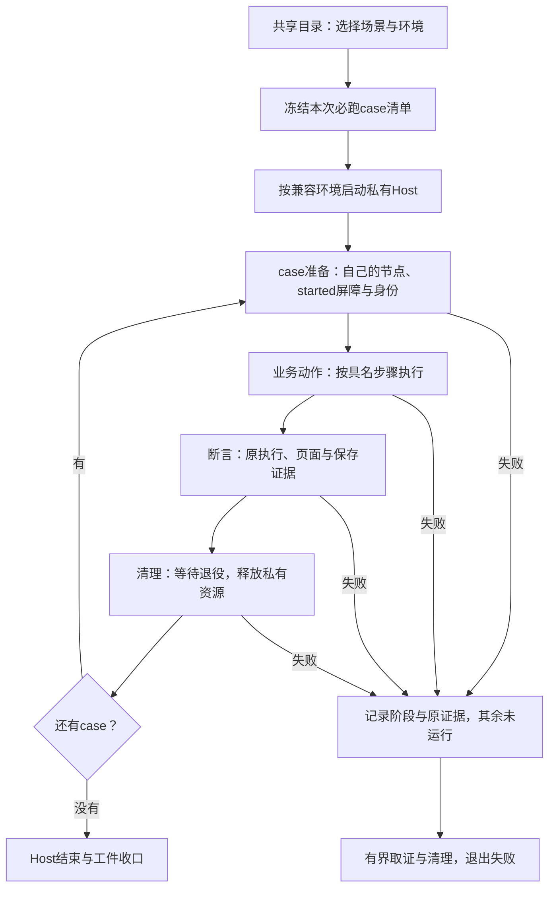

# Smoke 场景与子场景的验证边界重划

## 问题与范围

用户确认链接交互与停止应分开验证，并要求重新分析退出、重启和高输出响应等场景；随后要求整体门禁重新设计。本次选定按验证目标组织 smoke：一个场景回答一个产品问题，子场景对应同一问题的不同触发条件；有因果关系的动作保留为具名步骤。名称不再沿用历史修复批次。整体执行/产物/失败契约见[CI与发布门禁重设计](release-gate-redesign.md)；runner、目录与CI已实现初版并进入验证，正式输入和跨平台验收尚未完成。

研究输入为 `50e201caefb7c7d20ee2818455318fc33d8a2ba9`。设计研究时Linux源码默认19项、packaged默认8项、focused-only3项，以及 trusted/restricted 的109/38处直接 await 调用均进入[迁移清单](../references/release-gate-flow-audit/smoke-redesign/coverage-map.json)。调用点数量不是测试数量。原01–07的主要语义覆盖另外逐项映射；清单是拆分检查的输入，不代替逐条断言的实施 review。

原[六张现状图](../references/release-gate-flow-audit/smoke/README.md)继续说明已有流程。这里描述正式方案；本地诊断、Actions和发布验收分别记录，不能据图宣称执行通过。六平台原生资产 job 的 build/load 也不构成这些行为的验收。

## 现有分组为什么难以定位失败

`tests/vscode-smoke/extension-tests.cjs:206` 的 `local-links-and-stop`先运行链接，再运行 Codex Stop、Claude Stop及显式会话身份。链接与停止没有业务因果；分组来自历史专项验收。`verifyAgentExecutionFlow:5211`混合输入、状态推断、自然退出、再次启动和重复启动拒绝；`verifyPtyRobustness:9129`又包含 burst80、退出17、再次启动、Stop和并发。失败摘要只标原大场景，无法表达到底哪项契约没有完成。

`trusted`重复其中许多动作，又独有模板、Note、侧栏、通知、历史和文件活动。它还依赖先前节点标题、执行终态和返回的诊断证据。机械删除重复 helper 会丢失后置检查，机械切函数则会留下隐含 fixture 依赖。新场景必须显式准备自己需要的状态，并接收本用例产生的证据。

## 粒度选择

| 方案 | 好处 | 问题 | 当前判断 |
| --- | --- | --- | --- |
| 仅把06拆成链接与Stop，其余改名 | 改动小 | 01/07及trusted仍混合退出、重启、压力；失败归属仍不清楚 | 不足以满足本次要求 |
| 每条断言单独启动Host | 隔离直接 | 破坏原执行连续性，重复启动成本大；有因果步骤无法按同一身份验证 | 不采用 |
| 按目标分场景、按触发条件分子场景，保留有限组合流程 | 可定向运行，身份和失败阶段清晰，兼顾启动成本 | 需要迁移fixture与证据消费者，不能一次删掉旧链 | 已选定，验证中 |

## 正式方案

### 1. 场景、子场景、步骤与运行环境

**场景**是稳定的验证目标，例如 `execution-stop`。**子场景（case）**有自己的准备、业务动作、断言和清理，例如 `execution-stop/codex-queued-exit`。**步骤**是子场景内不可颠倒的因果过程，例如“排队退出9 → Stop → 验证退出0与尾部保存”。步骤有单独结果，但不能脱离前置原执行直接运行。**环境变体**表达源码/packaged、snapshot-only/runtime、provider、root与Host拓扑；不把环境名称当作新的产品目标。

筛选一个 case 时，必须从其准备开始完整运行，不能依赖之前 case 的节点、消息或全局标记。单Host可承载兼容fixture的多个 case，但每个 case 都重新建立自己的基线，等待自己资源退役后再清理。多个 case 共用Host是成本优化，不允许共用未声明的业务状态。

### 2. 原01–07重划为14个验证目标

下表编号只用于阅读，稳定标识是英文ID。表中的“现有”指有可迁移的旧断言，实现状态见本文末尾，未实现缺口不进入通过清单。Agent默认fake CLI，Terminal使用真实shell/PTY。

| # | 场景 | 子场景与验证逻辑 | 原主要来源 |
| --- | --- | --- | --- |
| 1 | `execution-start` 启动与准入 | `auto-start`：创建后原Agent/Terminal started；`duplicate`：活动执行再次Start被拒且身份/started数不变；`missing-cli`：未取得进程的准备失败，pending清除、一次反馈、保存not-required；`invalid-launch`：非法命令拒绝且不产生新执行 | 01/02/05、trusted失败路径 |
| 2 | `execution-io` 输入输出 | `agent-line`：完整命令与原输出；`agent-partial`：分段输入不提前提交；`terminal-line`：printf真实正文，排除命令回显；`live-snapshot`：原session的活动快照含已输出正文；`bounded-burst`：有限burst80末标记到达，原执行保持活动 | 01/07 |
| 3 | `agent-state-fixture` 受控状态推断 | `burst-prompt`：fake输出期间running、prompt后waiting-input；`sleep`：受控短暂静默仍running、完成后状态回落；`spinner`：slowspin重绘期间running、结束后回落 | 01 |
| 4 | `execution-exit` 进程退出 | `natural-zero`：主动命令exit0，Agent stopped、原尾部保存及读者结算；`nonzero`：exit17，error及准确摘要、原执行退役；`resumed-nonzero`：已成功resume后exit19仍是error，不能误报resume-failed | 01/07/03 |
| 5 | `execution-stop` 用户停止 | `agent`：明确Stop原Agent；`terminal`：明确Stop原Terminal；`codex-queued-exit`：Stop压过排队exit9，单SIGINT、退出0、Token usage/resume尾部、一次保存和原页面结算；`claude-graceful`：无需第二Ctrl-C或force-kill，无凭空恢复身份 | 01/06/07 |
| 6 | `execution-restart` 结束后新启动 | `after-natural`：exit0后显式Start；`after-error`：exit17后显式Start；`after-stop`：Stop后显式Start。均先确认旧资源退役，再等新started、新身份与新正文 | 01/07 |
| 7 | `canvas-reconcile` 画布与root重组 | `reread`：reload/setPersistedState不新增执行；`root-remap`：添加root后node路由变化但原执行继续输入；`remove-root`：被移除root执行保存并清理，原root执行保持 | 02 |
| 8 | `surface-continuity` 承载面连续性 | `cutover`：Editor→Panel→画布重读→Editor，原identity/generation及各阶段正文保留，结束后四标记仍在保存内容；`completed-reflow`：关闭后页面resize不覆盖已保存行列和序列化状态；`live-page-remount`：原Host仍持有执行时页面关闭/重建应继续，列为新增待验 | 04/01；最后一项是缺口 |
| 9 | `host-boundary-local` 本地Host执行边界 | `interrupt-and-flush`：模拟Host边界结束原local执行，等待原最终保存，Agent有可信恢复身份才resume-ready、Terminal interrupted；`explicit-new-start` / `manual-terminal-start`：边界后显式Start建立新执行，分别保留02的Agent/Terminal与03的Terminal路径；`preserve-terminal-state`：自然结束/用户Stop后的终态不因边界变interrupted，新增待验 | 02/03、trusted本地flush；最后一项是补充边界 |
| 10 | `agent-resume-context` Agent恢复身份 | `manual-resume`：中断后页面mount不自动恢复；用户resume建立新execution但沿用原provider身份，再确认resumed正文与输入；`claude-explicit-id`：文件确认的显式ID/strategy在Stop后保留；locator与hint parser各为独立子场景 | 03/06、trusted |
| 11 | `terminal-links` 链接交互 | `file-position`：真实页面文件链接打开正确行列；`image`：vscode.open/custom tab；`cwd-and-multiline`：cwd相对路径及多行rg结果；`missing-fallback`：找不到文件降级quickOpen；`url-and-osc8`：URL提示/浏览器路由与OSC8；`opener-error`：打开失败准确反馈 | 06 |
| 12 | `terminal-resource-drop` 资源拖放 | `first-resource`：真实页面拖入资源，仅消费第一个；含空格路径正确引用、原Terminal正文对应该资源 | 06 |
| 13 | `execution-concurrency` 普通并发 | `agent-terminal`：无压力时Agent/Terminal各自回应、各自原live快照正确；不串session、不让旧输出满足新执行 | 07 |
| 14 | `output-pressure` 输出压力 | `flood-fairness`：先单流持续输出，Note仍可选择、已有Agent仍响应；压力中创建第二Terminal与Agent，双流下新Agent仍响应；`ctrl-c-retains-session`：高输出前台命令Ctrl-C后，两原Terminal仍live且各自能printf新正文 | 07 |

链接和资源拖放只准备所需Terminal，不启动无关Agent。Stop用例各自准备provider，不先打开链接或启动HTTP server。异常退出正例不先跑Stop正例，重启用例自行建立自己的结束前提，压力用例不先跑快照恢复。

### 3. 每类证据的边界

| 目标 | 准备与触发 | 执行身份规则 | 通过证据与时间预算 |
| --- | --- | --- | --- |
| 启动成功/重复拒绝 | 等真实页面尺寸；创建或显式Start；再发重复请求 | 先确认原started；重复请求不能替换原identity | 原executionId/generation或runtimeSessionId，started事件与活动绑定；拒绝类别、原started数不增加。沿用旧started/状态等待预算 |
| 输入/有限输出/快照 | 只创建所需活动执行；发送不被回显误认的独有标记 | 全程同一原执行，快照也绑定该执行 | 连续正文或完整独立快照含marker；需要呈现的case另等真实页面正文。burst80旧断言只证明末标记，不能写成80行逐行完整性通过 |
| fake Agent状态 | 确定fake命令及其prompt/重绘时序 | 原执行不变 | 原正文+预期Host状态。保留sleep/slowspin现有定时观察；该结果只覆盖启发式受控输入 |
| 自然/错误退出 | 输入exit0/17，不发Stop作为业务动作 | 必须是本次原执行，不能用后续新执行终态 | 正确code/signal/状态/摘要，原资源退役；exit0现有保存、原reader applied、单次exit及finalOutputSequence全部迁移；其他旧断言逐项保留，新增完整终态证据需实施验证 |
| 用户Stop | 原started后发Stop；竞态case先确认sleep及queued exit | Stop作用于原执行，节点保留 | Host原节点stopped/closed、原进程/owner结束、保存与退役分别确认；Codex原reader、单次exit/单次保存及尾部必须保留。不得用fixture kill补成业务通过 |
| 新启动 | 自行建立自然退出、异常或Stop前提；先等旧退役 | 新execution；provider resume不属于此目标 | 旧退役屏障、新started、新身份及新标记。不能只凭live=false或sessionNotFound判旧存储已退役；沿用退役helper预算 |
| 页面/root保留 | 原输出后切面/重读/root变更；保存原身份 | 可重建页面/改node路由，原execution不变 | 新页面frame/generation与原执行对应；原输入/正文仍有效。移除root单独等待被移除执行保存；页面清理不得结束其他case执行 |
| Host边界/恢复 | 原started且fake trap已就绪；显式触发模拟Host边界 | local原执行结束，resume建立新execution；可信provider身份保持 | 原保存、原责任结算、正确恢复状态；页面mount零新增start；显式resume后新started及原providerId、正文。旧20秒恢复等待保持；模拟函数复用Host，不能代证真实Host退出 |
| 链接/拖放 | 私有文件、localhost server、单Terminal；等页面真实正文再交互 | 原Terminal不被替换 | 目标Editor URI/行列、custom tab/browser/quickOpen、准确反馈；链接marker与原页面绑定，排除旧history和回显。保留各旧8/10/20秒等待，不统一放宽 |
| 正常并发 | 串行完成各原started屏障，再并发I/O | 两个执行分别绑定，不混正文/快照 | 两份独有输出及两个原live snapshot；Stop只作为清理，以独立清理结果记录 |
| 高输出响应 | 持续输出已确认开始；在压力仍存在时操作Note/Agent/创建节点 | 原压力session保持，新增执行有自己的started | 现有Note选中8秒、Agent响应/节点创建15秒，第二输出流8秒；记录压力阶段和计数，不能在输出已结束后补验响应。尚无吞吐或p95产品承诺 |
| 压力下Ctrl-C | 独立准备双流前台无限输出，再发DOM输入Ctrl-C | 原Terminal身份保持且live | 两原Terminal在15秒内printf新marker；只中断前台命令。后续Stop结束PTY属于清理，不是Ctrl-C通过条件 |

所有数字是迁移现有测试预算，不是新定义产品SLA。准备、断言、清理分别计时；helper内部重试不续期，末次合法观察可以满足原deadline规则。Host级总期限是外层基础设施保护，须用迁移前后真实耗时校准后落实；本设计不凭空指定更长业务超时。当前实现按原helper清单冻结Host总期限，准备、业务、cleanup/exit与取证分账；基础设施预算仍待真实Actions校准。

### 4. 再次启动、resume与不同reload不能混用

`execution-restart`保留“先结束 → 原资源退役 → 再Start”的因果流程；其目标是新执行准入。`agent-resume-context/manual-resume`保留“原Host执行边界 → 保存恢复身份 → mount不自动继续 → 用户resume”的流程；其目标是用户手动继续及provider身份。`execution-exit/resumed-nonzero`独立建立已成功resume前提，再验证exit19分类；不能只由普通exit17推定恢复后分类正确。

`simulateRuntimeReloadForTest`复用同一manager/Host PID，主动调用Host边界清理、保存、重读并`owner.tryResume()`。它不调用真正Reload Window，不能被命名成“真实Host重开”。普通页面关闭/重建、切换承载面、画布重读，在原Host仍持有活动执行且无模式变更时，应验证原执行继续。真实Host是否退出和执行能否跨Host存活是另外两个问题。

现有03只在原执行已中断后关闭再打开Editor。它不覆盖live页面remount。新增live remount与自然/Stop终态保留列入待验证目录，不能宣称旧03已验。snapshot-only真实新Host恢复还需独立的新旧Host身份证据；runtime真实重开已有专门suite，不能替代snapshot-only的这项缺口。

### 5. 保留其余范围，去除trusted隐含依赖

| 场景家族 | 子场景组织 | 保留理由与实施边界 |
| --- | --- | --- |
| `canvas-entry` / `canvas-nodes` / `canvas-notes` / `canvas-sidebar` | 空画布与首次模板、panel/editor入口、创建QuickPick、布局/组/删除、Note编辑/清单/文件关联、侧栏列表与定位 | 当前trusted独有；每个helper对应可查case。Note标题/body等基线由自己的fixture建立，不读取旧长链改过的节点 |
| `execution-config` | provider/shell/scrollback/root默认值、缓存隔离及配置生效时机 | 包括Workspace override和explicit preset intent；按配置作用域准备与恢复 |
| `execution-notifications` | bridge迁移、注意信号、异常中断通知 | 通知是独立结果；仍需其原执行触发，不用普通error节点代证通知发出 |
| `terminal-view` | editor/panel tab viewport、workbench theme、snapshot-only/runtime scrollback与已完成历史 | 视口/主题不是I/O结果。不同模式的历史行为保持独立case |
| `canvas-protocol` | unknown消息toast、standby忽略、pending request故障、真实ready与隔离诊断 | fake诊断单独边界，不回滚真实页面ready/bootstrap；原协议/反馈断言仍保留 |
| `runtime-projection` | `checkpoint-current-state`保留运行态分页与Host重建后同session连续修订；`completed-no-history`完成后drain再丢弃history；`completed-page-reopen`结束后重开无旧正文；`legacy-completed-migration`旧stream完成数据清理 | 原checkpoint18000行与完整分页/codec/页面确认保留；focused completed-no-history迁入同家族，不能因末行可见删除分页完整性断言；旧数据迁移与运行期间恢复分开 |
| `runtime-recovery` / `runtime-mode` | 原session重连失败保持binding、stale自动resume忽略、恢复退出分类、立即边界；配置仅reload生效与主动关闭清理 | 原trusted与focused legacy reconnect都登记，迁移先保留两个不同fixture路径；删除重复前确认环境与状态相同 |
| `session-history` / `execution-file-activity` | restore/fork/search/doubleclick、Codex/Claude branch及拒绝；文件活动view/open与read-exit末尾drain | 恢复、fork有独有metadata/历史基线；observer drain不能由普通退出快照代证 |
| `restricted-workspace` | 空画布/Note、模板、webview与QuickPick拒绝创建、拒绝Start/input及overlay、reconnect/history-only delete、mode/history禁用 | 保留零真实执行契约；test seed节点不等于允许用户创建。不能套通用auto-start准备，禁止启动屏障等待不该出现的执行 |
| `supervisor-upgrade` | 固定v1、上一代stream、当前generation；attach/input/resize、旧Stop/Delete与新代不受影响 | Stop与resize在此验证升级连续性。保留原三代进程/session身份和旧客户端退役条件，不由普通Stop覆盖 |
| `runtime-reopen` | local、multi-root、single→multi、systemd成功/fallback、SSH原Host退出/保留 | 环境是case变体；setup→退出/保留屏障→离线完成→verify→原PTY resize不可切断。systemd成功仍是shim，不称真实manager验证 |
| `shared-runtime-windows` | owner/attacher结构同步、双向I/O与resize、Stop/Delete投影、模式切换/分阶段接管、最后空root重开 | 有跨窗口文件握手的组合流程。步骤单独报告，focused步骤必须从相应setup重建，禁止跳过前提；空root重开不能命名成原session恢复 |
| `runtime-compatibility` | Linux process.report不可用时activate | focused-only；必须独立Host且在activate前建立stub，不能在通用入口已经activate后运行 |

完整case名称与旧调用角色见[可读目录和映射](../references/release-gate-flow-audit/smoke-redesign/README.md)。目录包含152个拟议名称：137个现有覆盖的迁移目的地、15个新增待验；这是覆盖索引，不是152个新Host或已独立实现的测试。kind/provider变体和每个业务helper内部的断言还需在实施时进一步明确。trusted的`verifyTrustedDiagnostics`当前需要Agent、Terminal和准备失败返回的具名证据。迁移时将这些检查放回产生证据的case，跨case汇总只接收已验证且标明case/identity的结果；缺失任何必需证据失败。清空诊断缓存、替换节点或后续新session不能补足缺项。

不保留一个重复运行所有领域的巨型trusted旅程。若保留有限用户旅程，只选择有业务因果的“创建→编辑→保存→重读”或“运行→中断→手动恢复”，明确组合额外验证的契约及其单独fixture。旧trusted各helper与后置证据通过实施映射逐项迁移；新目录实际步骤、source/packaged对应输入均须验真，不能只删旧链再按静态目录声称等价。

### 6. 共享目录与源码/packaged覆盖

统一新增 `scripts/smoke/smoke-catalog.mjs`作为两个runner的声明式目录，字段至少为稳定scenario/case ID、中文目标、suite、环境要求、preActivation准备、fixture类型、具名步骤、各阶段预算、default-source/default-packaged/focused标记和证据要求。`scripts/gates/catalog.mjs`引用它冻结正式计划；两个runner消费同一计划并将具名任务序列化交给suite，suite只接受明确选择的case，不兜底执行trusted的未知case。此处与整体[门禁重设计](release-gate-redesign.md)统一目录路径，不再维护第二份CJS registry；这些程序文件已实现；真实来源/任务集合验证与本地诊断结果见活计划。

目录及所有case依赖必须由stage逻辑一起进入测试Host/packaged测试扩展，避免fixture依赖只在源码工作树存在。源码和packaged应运行相同产品case实现；payload来源是维度。packaged仍是开发Host承载生产包解出的payload，不是原样Marketplace双VSIX安装，测试报告须保留该限制。

| 迁移集合 | 源码默认 | packaged默认 | 准入条件 |
| --- | --- | --- | --- |
| 旧01–07及trusted中的现有业务case | 全部保留 | 全部保留旧八项覆盖的对应case | 去重是相同契约/环境fixture去重，不减少独有断言；先证明可独立执行 |
| restricted / 旧代 / 重开 / 双窗口 | 全部保留现有默认范围 | 保持原非默认范围，后续扩展需另给环境与证据 | 当前packaged从未默认跑这些专门suite，不能把迁移描述为已有等价覆盖 |
| 三个focused-only | focused状态保留；其中trusted已触达的相应语义仍在默认 | 保留旧trusted已有的相应语义 | legacy reconnect与completed-no-history保留专用fixture入口直至等价已验证；report unavailable仍仅Linux独立activate |
| 本设计新增缺口与真实provider TUI | 暂不成为新增必跑项 | 暂不成为新增必跑项 | 明确待验，不产生虚假的空case成功；补齐实现、受控反例及成本证据后再登记必跑范围 |

不能用“原19变成14”描述运行量：14是原01–07拆出的目标数，另有trusted领域与特殊拓扑；case数、Host数、平台变体数分别统计。发布完整入口先冻结必跑清单及其hash，拒绝任何继承filter减少范围；focused诊断只能显式选择目录内case并报告实际清单，未知名字、空集合、缺少必跑case直接失败。源码与packaged的filter语法一致。

默认顺序采用基础生命周期（启动→I/O→状态→退出→Stop→再启动）、视图/恢复、链接/拖放、并发/压力、其余领域、restricted及特殊拓扑。目录顺序不构成case依赖。按持久化模式/信任/preActivation要求分Host；复杂旧代与重开不为节约启动成本混入普通Host，压力使用独立Host隔离负载。测量迁移前后总耗时后再确定普通case合并Host的数量，不无依据全平台×模式×provider展开。

### 7. 结果、失败与清理契约

每个结果携带输入SHA、payload/原生资产摘要、环境、scenario/case/step、阶段、开始/完成时间和deadline，以及Host PID/启动身份、Supervisor owner/profile/PID、原node/root/session/execution/generation、页面frame/readId/revision等适用身份。身份不存在时写原因，例如准备失败未取得PTY；不能编造PID。

阶段结果为 `passed / failed / timed-out / not-run`，阶段为 `prepare / action / assert / cleanup / host-exit`。整体case只有业务断言及必需清理均成功才通过；业务通过但清理失败明确显示两者各自结果，并使整个run失败。业务已失败时，清理错误是附加失败，不覆盖原首败。case内首败后续业务步骤`not-run`；只有能证明fixture完全清理时，同Host可继续其他独立case收集证据，整场仍失败；清理未知/失败则停止本Host组，其余case `not-run`。无依赖的其他job继续运行，聚合不把缺结果或拼接结果合成完整通过，统一按整体门禁规则收口。

Stop业务完成、保存完成、reader消费、存储退役、Host退出与Supervisor退出分别记录。私有夹具资源回收可kill，但必须记录发生在取证/清理，并且不能修改先前业务failed。普通runtime窗口关闭不等于远端Host退出；SSH exit/retain按原PID/startTicks建立前提，离线Terminal完成另设屏障。真实resize按原进程几何验证，禁止由“没有owned-resize-failed”或停后尺寸保护代替。

上述离线完成屏障是统一报告的拟议契约：当前本地重开在setup结束后固定等待3秒，随后verify检查完成；SSH已在外层独立观察Terminal完成。迁移可把本地等待改成原session有界完成屏障，但须补实际验证，不能将现有本地固定等待写成已有独立轮询。

失败先保存有界现场再清理：当前/最后有效snapshot、原身份诊断、真实页面probe（含采样时间与新鲜度）、进程状态、stdout/stderr、当前步骤与等待predicate。工件收集本身有期限并记录失败，避免再次无界等待。不把受控夹具成功或缺失现场的推断写成历史CI根因。

## 实施迁移与验收

1. 先添加共享目录、具名case/step和阶段结果，但保留所有旧调用；冻结源码/packaged旧覆盖与本清单，新增filter校验和完整入口范围保护。
2. 分离fixture：优先链接、拖放、Stop、exit/restart及压力。每个case可独立筛选运行；同fixture复用须不共享未声明状态。保留原started、保存、退役、正文/页面和resize断言。
3. 对trusted领域迁移自己的基线与证据消费者，source/packaged共用case。逐条review旧helper内部断言与新case去向，本清单不会自动证明实现等价；新旧case短期并行验证，不能长期双跑。
4. 证明链接失败不会阻止定向Stop，Stop失败不会阻止定向链接；nonzero、restart、flood和restricted独立运行。验证unknown/empty/filter缩减拒绝，缺少证据失败，业务失败与清理失败区分。反例验证用真实边界或有意义的受控故障，避免仅测试registry读写。
5. 完成等价后移除trusted重复调用与旧别名，保留旧代/重开/双窗口组合的独有前提；记录case与Host运行量及耗时变化。用同输入SHA/同run六平台原生资产跑原完整`release:verify`，再按WORKFLOW对PR327最新正式预合并输入重跑。

设计阶段的源码hash、入口/调用映射、case引用和文档链接检查只证明结构。2026-10-18实施已实际运行四轮Actions，第四轮118源码Host/2 Marketplace Host及packaged103/104通过；安装和剩余case失败仍阻止完整acceptance。生产恢复撤销订阅竞态未修，PR327未放行。

## 待验证假设与补充目录

真实TUI的输入可用、回答呈现与回合完成需分别验收。底部一直可输入不代表回合完成，回答不在最后一行也不是错误。待验证case应覆盖处理中可输入、回答后还有footer、网络/工具等待静默、结束后重绘，并以独立provider信号确认完成；信号接入尚未选定，fake waiting-input不能自证。既有[技术债](../exec-plans/tech-debt-tracker.md)保留。

补充但尚未实施的范围包括：local活动执行的真实页面remount、snapshot-only真正新Host手动恢复、自然结束/Stop后Host边界终态保留、Terminal自然/异常退出后的独立重启、挂起/不响应Stop的升级与失败路径、高输出完整性与真实TUI回合状态。exit17是命令触发非零退出，不等于原生崩溃；后者需独立故障模型，不能以更名获得覆盖。普通live resize独立正例及压力下resize也需明确目标，现有重开/旧代几何检查不得删除。

这些缺口先明确目标和独立证据，再补fixture和预算；本设计不把未实施case计入必跑通过，也不自动扩大本版发布阻塞范围。Host分组是否节省总时间、真实provider完成信号是否稳定和新增压力前提是否可重复，均需后续实际验证。

## 当前实施与验证状态（2026-10-18）

第八轮PR335与PR327组合分别321/324和327/330 required通过，均失败且无acceptance。source两批各117/118，首败分别是real-reopen新页面原45秒未ready和file/views原10秒缺文档focus；当前外部只读CDP诊断同原测试动作通过不能追认历史。安装层中文Stop按固定新增节点的公开标题栏双击满足概览退出/精确名称可见可用，随后只点击一次；原生产bundle回归及427功能/3视觉通过，原429登记未删。macOS locale隔离用公开Quit，原应用和原Host退出分别在原30秒核对。两项生产竞态、三平台新输入及完整source/packaged来源验收仍须独立收口。

`scripts/smoke/smoke-catalog.mjs`现登记102个独立product-case、13个默认因果suite和3个focused诊断。独立case各自从prepare开始，以实际执行的prepare/action/assert step写Host回执；旧代、多窗口、真实重开等继续保留完整因果步骤和原身份。源码默认115项加3个notifier/locale辅助，packaged默认102项加2notifier辅助；两个Marketplace Host单独归层。152个设计目的地由`scripts/smoke/smoke-implementation-map.json`完整映射：137现有目的地为implemented-unverified，15proposed-gap为not-implemented。数字不是实跑通过数；任何mapping或AST检查都不能签发acceptance。

本地独立fixture、特殊拓扑及Marketplace新Host包装器已有真实诊断和保留的首败→修正→复验证据，详见[实施计划](../exec-plans/active/release-gate-implementation.md)。其输入是当前工作树与旧dist/native，不外推新SHA、六native或原样安装。原产品resize/ready/Stop/保存/reader等待保持，修正只解决明确夹具前提：mounted/fit尺寸、Host原身份传递、短systemd/VSCode socket、Remote SSH官方依赖及环境、已空graph避免重复reset、locale语言包。

fake Agent输入区状态仍只覆盖受控启发式，不证明真实TUI回合完成，也不假设回答位于末行。live remount、真实snapshot-only新Host、原生崩溃/Stop不响应及额外压力范围仍按15项未实施缺口记录。产品旧代恢复撤销订阅竞态未修，不能因重划case或延长期限让该确定故障通过。

第四轮39097246318保留正式输入aa969012/headcdf40738及全量330task来源，六native操作、118源码Host、2 Marketplace Host和packaged103/104同批通过；失败包文件视图存在合成MouseEvent.view=null，三个原样安装仍失败。对应fixture修正已做Linux原双包公开全流程及minimal/card原包先红后绿回归，acceptance=false。新head全部source/packaged/三安装和PR327组合仍待验，不能将运行量、静态137项映射或诊断拼成完整通过；原15个新增目标继续不进入虚假成功清单。

第五轮39101493143实际source115/118、packaged103/104失败，PR327临时组合39101774719则source118/packaged104同批通过，原样安装macOS/Windows两项仍失败；两个批次均无acceptance。当前文件输入按原URI/group关闭、真实中心命中和动画稳定准备/完整primary pointer修正，保原产品等待、split/mounted和reader断言；当前源码production+旧native的完整文件视图诊断通过，不代证新head正式packaged。真实浏览器428→429保原428，426功能/3视觉及105合同同批通过；123 suite预算逐项未变。实际来源与未验边界见[实施证据](../references/release-gate-redesign/implementation/local-results.json)。

第六轮39108395021和最新0.26.1组合39108780795已终态，组合source118/packaged104全部通过但两平台URI用户确认仍失败。第六轮额外source panel点击缺文档焦点与runtime-mode删除期间pending回调失败。panel公开focus和URI真实确认已补，原10秒/20秒及完整后置断言保持，最终108合同同批通过；三平台新head尚待验收。mode-switch在生产deactivation同样复现，继续保原case和业务时序，不加等待/retry，未修责任见[共享模式边界](runtime-shared-root-canvas-sync.md#ci-改造时发现的模式切换回调边界2026-10-18)。生产既有恢复订阅竞态也未豁免。
