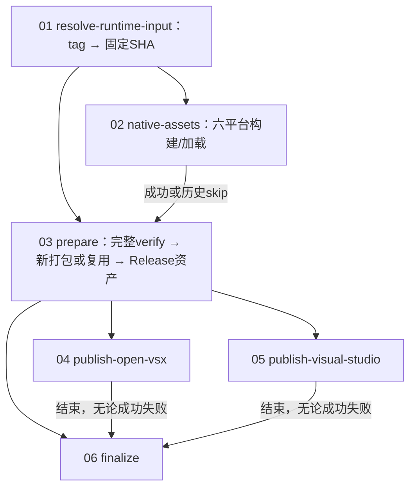

# 两组 CI 的 job 内部执行与验证

本说明展开六个平台原生资产 CI 和发布 workflow 的六个 job。发布的 `native-assets` job 调用 reusable workflow，内部再展开六个平台；两组是包含关系。图和清单记录当前代码流程，本次没有执行发布或重跑跨平台门禁。

审查源码输入为修复分支 `84624eaf6e0bdb883fdf215c1d1de5138c930789`，与上一轮审查的 main/PR327 发布材料关系见 [审查报告](../../design-docs/release-gate-flow-audit.md)。原始 workflow 条件、命令和输出完整保存在 [发布六 job 源码快照](publish-jobs/source-jobs.json)；六平台逐步代码位置见 [原生资产代码映射](native-jobs/source-map.json)。

## 图的入口

每张平台图有两条独立泳道，分别展开 x64 与 arm64 的全部步骤。蓝色方框为执行，绿色为契约、字节或版本校验，紫色为真实原生加载，灰色为取证或边界说明；红色为失败或跳过。渠道图按成功路径顺序展开，PAT 缺失等跳步条件写在对应方框和下文，不能把每个方框理解为无条件执行。

| 内容 | PNG | 可缩放 SVG |
| --- | --- | --- |
| Linux 两个 CI：各 15 步 | [PNG](native-jobs/linux-jobs.png) | [SVG](native-jobs/linux-jobs.svg) |
| macOS 两个 CI：各 16 步 | [PNG](native-jobs/macos-jobs.png) | [SVG](native-jobs/macos-jobs.svg) |
| Windows 两个 CI：各 18 步 | [PNG](native-jobs/windows-jobs.png) | [SVG](native-jobs/windows-jobs.svg) |
| 每个最小/当前宿主的加载检查 | [PNG](native-jobs/native-load-detail.png) | [SVG](native-jobs/native-load-detail.svg) |
| 发布 job 01–02：解析与原生资产 | [PNG](publish-jobs/resolve-native.png) | [SVG](publish-jobs/resolve-native.svg) |
| 发布 job 03A：prepare 准入与完整验证 | [PNG](publish-jobs/prepare-validation.png) | [SVG](publish-jobs/prepare-validation.svg) |
| 发布 job 03B：prepare 新打包/复用与交付 | [PNG](publish-jobs/prepare-artifacts.png) | [SVG](publish-jobs/prepare-artifacts.svg) |
| 发布 job 04–05：两个渠道逐步对照 | [PNG](publish-jobs/channels.png) | [SVG](publish-jobs/channels.svg) |
| 发布 job 06：finalize 汇总与删 tag 条件 | [PNG](publish-jobs/finalize.png) | [SVG](publish-jobs/finalize.svg) |

## 六个平台的原生资产 CI

入口是 `.github/workflows/runtime-execution-assets.yml`。发布调用传入 `input_ref`，不启用独立手动入口的 `windows_only`；当前发布路径运行全部六平台。六个 job 并行，`fail-fast=false`，每个上限 20 分钟。每个 job 内普通步骤串行；首败跳过后续普通步骤，最后尝试 `always()` 取证。runner 消失或平台强制终止时不能保证上传。

| target | 原生 runner | 编译环境 | 最小加载宿主 | 当前加载宿主 |
| --- | --- | --- | --- | --- |
| linux-x64-glibc | ubuntu-24.04 | 固定 SHA 的 Node16.17.1-buster x64 容器 | 容器 Node16.17.1 | runner Node25.6.0 x64 |
| linux-arm64-glibc | ubuntu-24.04-arm | 固定 SHA 的 Node16.17.1-buster arm64 容器 | 容器 Node16.17.1 | runner Node25.6.0 arm64 |
| darwin-x64 | macos-15-intel | clang++ / xcrun SDK / Node25.6.0 headers | 同 runner Node16.17.1 x64 | runner Node25.6.0 x64 |
| darwin-arm64 | macos-15 | clang++ / xcrun SDK / Node25.6.0 headers | 同 runner Node16.17.1 arm64 | runner Node25.6.0 arm64 |
| win32-x64 | windows-2025 | MSVC x64 / Node25.6.0 headers+node.lib | 同 runner Node16.17.1 x64 | runner Node25.6.0 x64 |
| win32-arm64 | windows-11-arm | MSVC amd64_arm64 / 对应 headers+node.lib | Electron22.3.14 arm64（Node16.17.1） | runner Node25.6.0 arm64 |

所有平台先 checkout 固定输入 SHA，配置实际目标架构的 Node25.6.0，执行 `npm ci --no-audit --no-fund`，再跑 `test-execution-distribution-assets.mjs`。这项契约回归使用合成资产和 mock load；随后 builder 的两次加载才是真实 `require`。Windows 还在 checkout 前关闭 autocrlf，并初始化对应 MSVC 环境。

### 构建阶段实际校验什么

| 环节 | 执行 | 验证及边界 |
| --- | --- | --- |
| 所有 builder | 选择固定 target，创建独立输出目录 | HEAD 为完整 40 位 SHA且等于传入输入；platform/arch及Node25.6.0精确匹配；禁止覆盖已有候选目录 |
| Linux | 固定 digest、正确架构容器，`--network none`，仓库只读；g++ C++17/N-API8 编译 addon | Node16.17.1 headers、固定 node-pty/addon-api、源码与资产 hash；实际 ELF64 架构/type；GLIBC≤2.28、GLIBCXX≤3.4.22、CXXABI≤1.3.9。容器沿用 runner 内核 |
| macOS | 下载 Node25.6.0 headers；clang++ 编译 addon 与 spawn-helper；下载最小 Node16.17.1 | 下载内容匹配供应 SHASUMS256；供应源码/文件 hash；实际 Mach-O 架构、type与load commands；x64 deployment10.13、arm64 11.0；helper可执行。没有启动旧版macOS或实际运行helper |
| Windows | 下载对应 headers/node.lib；`cl.exe /MT /DELAYLOAD:node.exe` 编译 conpty.node，放入固定 ConPTY 依赖；下载最小宿主 | headers/lib及供应源码 hash、ConPTY1.25.260303002；addon/DLL/EXE 的PE架构/type/hash；解析实际导入表拒绝动态CRT。minimumBuild17763仅manifest声明，没有在旧版Windows运行 |

### 两次真实加载的共同验收

`check-execution-native-load.cjs` 在最小宿主和当前宿主各完整执行一次：读取绝对路径下 schema2 manifest，核对实际 platform/arch、精确 Node/Electron 版本、N-API要求8与宿主能力≥8，确认 `manifest.verification.productValidated=false`，校验 binary/helper/dependencies 的全部 SHA256，然后真实 require `.node`。导出名称必须与 manifest 相同，且每项为 function。

两报告的 manifest SHA 和 binary SHA 必须相同，才可归档。报告包含 OS/runtime及 Linux glibc 观测；summary明确 `nativeLoaded=true`、`executionApiCalled=false`、`productValidated=false`。因此六平台不验收启动、读写、resize、stop、Agent或真实ConPTY会话。它们证明编译、文件契约和两个宿主加载成立。

成功上传 `execution-native-<target>-<run_id>`，内含 runtime-only tar.gz 与 finite summary，保留14天。Linux归档 manifest/addon；macOS多spawn-helper；Windows归档 manifest/conpty.node/conpty.dll/OpenConsole.exe。末尾 `execution-native-evidence-<target>-<run_id>-<run_attempt>` 尝试保存候选文件和 minimum/current-load.json，缺文件warn，保留14天。

构建/解包/加载子命令默认上限300秒，供应 checksum与文件下载各120秒；外层20分钟是整个job的上限。这些预算用于资产流水线，不是产品resize或ready的等待预算。

## 发布 workflow 的六个 job

入口为 `.github/workflows/publish-marketplace-release.yml`，由 `publish/v*` tag push 或带 `trigger_tag` 的手动 dispatch 触发。按 trigger tag 串行化同版本运行，`cancel-in-progress=false`。workflow具有contents写权限，解析与原生资产两个job降为只读。

`prepare` 必须在 resolve成功且native成功/skip时才运行；两个渠道只在prepare成功后运行。`finalize` 使用 `always()` 等两个渠道结束，但仍要求prepare成功。

| job | runner / timeout | 核心验证 | 输出/后续 |
| --- | --- | --- | --- |
| 01 resolve-runtime-input | ubuntu-latest / 未显式设置 | 解析实际tag checkout的HEAD；检查装配脚本存在 | input_ref、needs_assets |
| 02 native-assets | reusable / 每平台20分钟 | 上述六平台构建与两宿主真实加载 | 同run六份tar+summary；任一失败挡prepare |
| 03 prepare | ubuntu-22.04 / Node22 / 90分钟 | 同ref资产、完整release:verify、版本/ref/hash/tag | GitHub Release三资产及prepared artifact |
| 04 publish-open-vsx | ubuntu-latest / Node22 / 45分钟 | 原VSIX一致性；两扩展目标版本及文件链接metadata | 本渠道manifest/status；发布失败job失败 |
| 05 publish-visual-studio | ubuntu-latest / Node22 / 45分钟 | 原VSIX一致性；gallery目标版本存在 | 本渠道manifest/status；业务失败允许deferred |
| 06 finalize | ubuntu-latest / 20分钟 | 两扩展Open VSX完成；删tag前两个ref匹配 | 最终notes/manifest/artifact；未完成exit1 |

### 01 resolve-runtime-input：两步

1. Checkout trigger tag，`persist-credentials=false`。只接受dispatch，或非删除且匹配publish/v前缀的push。
2. `git rev-parse HEAD` 输出 `input_ref`；按 `assemble-execution-distribution-assets.mjs` 是否存在输出 `needs_assets=true/false`。没有测试或正式发布动作。

失败时后续native及prepare无法准入。历史ref没有装配脚本时native跳过，prepare走历史兼容路径。当前0.26.1需要六平台资产。

### 02 native-assets：调用而非另一次打包

依赖resolve，仅在 `needs_assets == true` 时调用原生资产reusable workflow并传递固定SHA，展开上文六平台。它不生成VSIX；prepare只下载同workflow run的原生工件。

### 03 prepare：原 YAML 的十九步

| 步骤 | 执行/验证 | 条件与结果 |
| --- | --- | --- |
| 1 | Derive release metadata：严格解析publish/vX.Y.Z | 输出version、final_tag、manifest/main/notifier路径 |
| 2 | Checkout release ref | 使用resolve的固定input_ref，fetch-depth=0 |
| 3 | Resolve release ref | HEAD记录为release_ref |
| 4 | Setup Node.js | Node22，npm cache |
| 5 | Install dependencies | npm ci |
| 6 | Install release verification browser | 有preflight脚本时安装匹配Playwright Chromium及系统依赖 |
| 7 | Download same-run native runtime assets | needs_assets=true；下载execution-native-*同run工件 |
| 8 | Assemble same-ref native runtime assets | needs_assets=true；核对输入/六target/archive hash/白名单/regular file，设置EXECUTION_ASSETS_SET |
| 9 | Verify release input | 有preflight脚本执行release:verify；历史无脚本明确skip |
| 10 | Detect existing GitHub Release assets | 404→package；三份完整→reuse；缺资产/非404 API错误→失败 |
| 11 | Download existing GitHub Release assets | reuse；按精确名称下载三份非空文件并放回约定路径 |
| 12 | Validate existing GitHub Release assets | reuse；release:publish-tag --skip-package --package-only |
| 13 | Package release artifacts | package；release:publish-tag --package-only，notifier→main |
| 14 | Create final release tag | 已有本地/远端正式tag必须等于release_ref；缺失时创建/推送 |
| 15 | Record final release tag in manifest | finalTagStatus=pushed |
| 16 | Write GitHub release notes | 该版本CHANGELOG和manifest生成notes |
| 17 | Create or update GitHub Release assets | package；创建/更新Release并上传三产物，--clobber |
| 18 | Update GitHub Release notes for reused assets | reuse；只更新notes，保留原VSIX |
| 19 | Upload prepared release artifacts | prepared-release-<run_id>；缺产物error；供两渠道和finalize下载 |

第9步是产品完整门禁：静态preflight和门禁回归 → 串行npm test（含源码默认19场景）→ Webview Playwright → clean-checkout VSIX验证（默认8场景）。内部详见 [完整验证图](verify-detail.svg)、[smoke内部六图及验证完成条件](smoke/README.md) 和 [审查报告的覆盖清单](../../design-docs/release-gate-flow-audit.md#标准验证的具体顺序和覆盖)。0.26.1不采用0.26.0的历史例外。

第12/13步的helper都会验证版本、静态preflight、HEAD=trigger-tag ref、工作区干净且releaseRef属于origin/main历史。新打包核对每份VSIX的name/publisher/version、主扩展README含release ref及文件SHA；复用还要求原manifest版本/ref一致，原VSIX的SHA与对应artifact记录一致。这两步不重新执行完整宿主门禁。

prepare输出 `version/release_ref/final_tag/manifest_path/main_vsix/notifier_vsix`。任何普通步骤失败即停止后续；此job没有always的完整verify失败现场上传。部分外部资产已上传后失败不会自动回滚；下一次发现Release缺任何一个必需资产会拒绝重新打包，需人工恢复。

### 04–05 两个发布渠道：各九步

两个job并行使用prepare同一批产物，各自按notifier→main顺序发布。以下序号对应各自原YAML的九个step；图将helper内部“查询/发布/验真”继续展开。

| 步骤 | 两渠道共同动作 | Open VSX | VS Marketplace |
| --- | --- | --- | --- |
| 1 | Checkout release ref，fetch-depth=0 | checkout临时trigger tag名 | checkout临时trigger tag名 |
| 2 | Setup Node.js，npm cache | Node22 | Node22 |
| 3 | Install dependencies | npm ci | npm ci |
| 4 | Download prepared release artifacts | 同run prepared-release | 同run prepared-release |
| 5 | Verify secret | OVSX_PAT；缺失status=1，本step exit0 | VSCE_PAT；缺失status=1，本step exit0 |
| 6 | Validate release artifacts | PAT存在时skip-package/package-only，验版本/ref/VSIX hash | 相同 |
| 7 | Publish and verify | PAT存在时target=open-vsx；捕获命令status | PAT存在时target=visual-studio；捕获命令status |
| 8 | always上传结果manifest | marketplace-result-open-vsx-<run_id> | marketplace-result-visual-studio-<run_id> |
| 9 | 发布未完成后的处理 | status非0则exit1 | 记录deferred说明，业务失败不主动exit1 |

PAT缺失跳过6/7；此前安装、下载或输入校验等硬失败仍可导致job失败。结果上传缺文件为warn，不保证一定有新的渠道结果。job输出status取发布命令、secret检查结果或默认1；finalize的完成判断来自manifest条目，不直接依赖job绿灯或该status输出。

发布helper先查目标版本，manifest已verified或远端版本已存在时跳过发布；否则发布原VSIX，失败后继续尝试另一扩展。所有发布都带 `--skip-package --no-create-final-tag`，两个job不创建正式tag，也不删除trigger tag。

发布后默认最多12轮查询，间隔30秒；单次metadata请求60秒，Open VSX发布命令预算600秒，仍受45分钟job总预算限制。Open VSX确认目标version以及download/icon/license/sha256/vsixmanifest链接存在；VS确认gallery API包含目标version。这里没有下载远端VSIX再与本批SHA比对，不能宣称渠道字节一致已验真。复用manifest中的verified状态会被保留。

### 06 finalize：原 YAML 的九步

| 步骤 | 执行/验证 | 条件与结果 |
| --- | --- | --- |
| 1 | Checkout临时trigger tag | fetch-depth=0；这里没有setup-node或npm ci |
| 2 | Download prepared release artifacts | 同run原manifest和两VSIX |
| 3 | Download Open VSX result manifest | continue-on-error=true；下载失败继续 |
| 4 | Download VS result manifest | continue-on-error=true；下载失败继续 |
| 5 | Merge marketplace manifests | 有对应分支则覆盖；缺分支保留prepared里的原值；计算完成状态 |
| 6 | Update GitHub Release manifest and notes | 更新notes及汇总manifest |
| 7 | Delete temporary publish tag | 仅release_complete=true；核对正式/临时tag都等于release_ref，删除后记录deleted并再次更新notes/manifest |
| 8 | always上传最终工件 | marketplace-release-<run_id>；含release-artifacts、两VSIX、渠道结果；缺文件warn |
| 9 | Fail when marketplace publish failed | release_complete不是true则exit1；保留临时tag供重跑 |

第5步要求main/notifier的Open VSX状态各为verified或already-published，才设置release_complete=true。两渠道都完成为complete；Open VSX完成但VS未完成为complete-with-deferred-visual-studio；Open VSX不完整为publish-failed。GitHub资产完成由prepare成功的交付路径提供，finalize不会重新下载远端资产并验hash。

外部发布不是原子事务：部分已发布不会自动撤回。完成状态满足也不能豁免后续notes更新、ref校验或删tag失败；这些硬失败仍会令finalize失败。always上传只是尝试保存当前可用产物，不是“失败一定具备全部现场”的保证。

## 核对与复现

本次只补流程说明和图，不修改workflow、产品代码、测试契约或渠道策略。两份source JSON保存输入SHA/hash；发布原YAML共48个step和reusable调用均保留。九张图使用fireworks-tech-graph，严格标签、showcase质量；JSON schema及SVG几何/碰撞/箭头/布局检查通过，PNG宽2400，已逐图视觉检查中文字、文字完整性、箭头与边距。验证结果见 [原生图检查](native-jobs/validation.json)、[发布图检查](publish-jobs/validation.json)及 [源码与文档核对](job-detail-validation.json)。

图生成器为 [native-jobs/generate.py](native-jobs/generate.py) 和 [publish-jobs/generate.py](publish-jobs/generate.py)；源码快照解析使用任务外现有PyYAML。渲染工具和CairoSVG只作为本机工具，不加入项目依赖。SVG为canonical，PNG用于预览。源码/清单/链接核对可运行 `python3 docs/references/release-gate-flow-audit/verify-job-details.py`；视觉确认单独记录在 [visual-review.json](visual-review.json)，不会因静态核对重跑而自动宣称完成。
