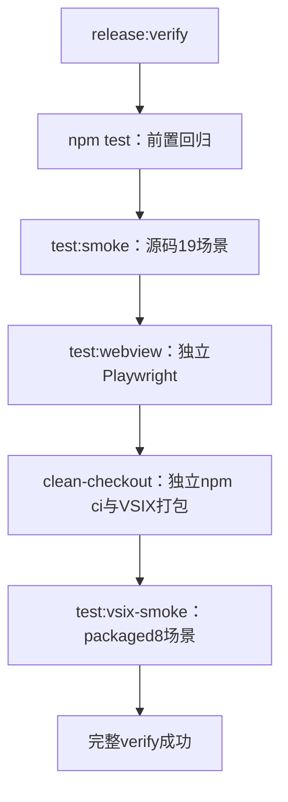

# Smoke 的现有流程设计

本说明展示当前发布门禁实际运行的 smoke 流程。源码输入固定为 `9aaa05b0`，本次只读取实现、整理流程与校验图，没有运行新的 smoke、改变断言或实施生产修复。发布前 PR 的 `verify-release-contract` 与发布时 `prepare` 第9步都会进入 `release:verify`；这里展开其中的真实 VS Code 宿主测试。

设计分为三层：外层 Node runner 选择场景、建立私有环境并启动 VS Code；Extension Host 内的测试 suite 触发产品操作并串行断言；真实 Webview、执行进程和 Supervisor 提供观测结果。Supervisor 是独立于窗口的执行管理进程，长期运行不代表其某个终端会话没有退出。

## 流程图入口

| 图 | 要看什么 | SVG | PNG |
| --- | --- | --- | --- |
| 01 | 源码19场景、packaged8场景的入口和顺序 | [入口与场景](entry-scenarios.svg) | [PNG](entry-scenarios.png) |
| 02 | 单个Host从环境准备到结果、异常取证 | [单Host流程](single-host.svg) | [PNG](single-host.png) |
| 03 | trusted长功能链与restricted拒绝路径 | [suite内部顺序](trusted-restricted.svg) | [PNG](trusted-restricted.png) |
| 04 | 本地重开、systemd与远端Host退出/保留两态 | [两阶段重开](real-reopen.svg) | [PNG](real-reopen.png) |
| 05 | owner/attacher并发、文件握手与共享状态 | [双窗口](two-window.svg) | [PNG](two-window.png) |
| 06 | 最近首败的旧代Stop，及原进程resize验收 | [旧代与resize](legacy-resize.svg) | [PNG](legacy-resize.png) |

蓝色为执行，绿色为断言，紫色为等待，红色为失败。泳道表示不同路径或窗口，含义见各图标题；只有双窗口图对应同一场景的两个并发Host。图03按真实调用顺序归组，完整直接await调用及行号见 [source-map.json](source-map.json)：trusted 109处、restricted 38处。这些是调用点数量，不是独立测试用例数量，也不包含helper内部的所有断言。

## 1. 入口和执行顺序

`release-preflight.mjs:237` 的标准完整验证先做静态检查与门禁回归，再运行 `npm test`，最后运行 `validate:clean-checkout:vsix -- --ref HEAD`。`npm test` 前面还有大量单元/协议/Marketplace测试，到尾部才运行 `test:smoke`，随后运行独立的 Playwright `test:webview`。Webview套件与真实VS Code smoke是不同测试入口。

每条链首败即抛错，后续未触达不计通过；没有整场自动重试。六平台原生资产在进入这条链前已构建、装配；它们的加载通过不能替代下面的产品行为验证。

### 源码默认19场景

`test:smoke` 先执行主扩展及notifier构建，再进入 `run-vscode-smoke.mjs`。发布门禁的Linux环境按以下顺序串行运行：

| 顺序 | 场景 | 主要验证责任 | suite |
| --- | --- | --- | --- |
| 1 | local-execution-flow | Agent/Terminal输入输出、部分输入、burst、重启、拒绝重复启动、最终保存 | extension-tests |
| 2 | owned-canvas-reconciliation | reload及workspace组合后仍属于原执行 | extension-tests |
| 3 | snapshot-only-manual-recovery | snapshot恢复保留手动Agent恢复语义，禁止自动resume | extension-tests |
| 4 | local-surface-cutover | Editor/Panel切换与重新读取画布后的原会话输出 | extension-tests |
| 5 | local-preparation-failure | 缺CLI时未启动节点结算及准确的一次错误反馈 | extension-tests |
| 6 | local-links-and-stop | 页面终端链接、原执行Stop完成、queued-exit及Claude上下文 | extension-tests |
| 7 | local-pty-robustness | PTY退出/重启、并发输出及画布响应 | extension-tests |
| 8 | runtime-checkpoint-refresh | 原Supervisor输出、分页投影/checkpoint和完成后的历史丢弃 | extension-tests |
| 9 | trusted | 完整可信工作区功能链，见图03 | extension-tests |
| 10 | restricted | 拒绝执行/输入，Note与诊断可读，见图03 | extension-tests |
| 11 | legacy-supervisor-upgrade | 旧v1、上一代stream与当前generation兼容、resize、Stop/Delete | legacy-supervisor-upgrade-tests |
| 12 | real-reopen | 本地setup退出后verify原session恢复及离线完成 | real-reopen-tests |
| 13 | multi-root-real-reopen | 同multi-root重开，执行storage保持root归属 | real-reopen-tests |
| 14 | single-to-multi-root-real-reopen | single→multi组合后仍使用原root的session/storage slot | real-reopen-tests |
| 15 | two-window-shared-runtime | 共享Note结构、双向输入、resize/stop/delete、持久化开关及接管 | two-window-shared-runtime-tests |
| 16 | systemd-user-real-reopen | fake systemd成功路径的两阶段恢复 | real-reopen-tests |
| 17 | systemd-fallback-real-reopen | 提交前缺user bus时fallback，确认没有提交systemctl命令 | real-reopen-tests |
| 18 | remote-ssh-real-reopen-exit | localhost SSH断client后原远端Host明确退出；Supervisor继续存活 | real-reopen-tests |
| 19 | remote-ssh-real-reopen-retain | 原远端Host身份明确保留；新窗口继续原session并验resize | real-reopen-tests |

源码还有 `runtime-legacy-reconnect`、`linux-runtime-report-unavailable`、`runtime-completed-no-history` 三项focused-only，必须显式选中，不属于默认19项。源码filter接受逗号分隔集合；packaged filter只接受一个八项列表内的精确场景名。前者没有未知名称的统一拒绝校验，过滤后的通过不证明完整场景已运行。19项口径针对发布Linux路径；例如旧代suite在Windows明确skip，SSH只在Linux运行。

### Packaged默认8场景

顺序为 `owned-canvas-reconciliation → local-execution-flow → snapshot-only-manual-recovery → local-surface-cutover → local-pty-robustness → local-preparation-failure → local-links-and-stop → trusted`。它复用源码的 `extension-tests.cjs`，没有默认packaged restricted/legacy/reopen/systemd/SSH。

clean-checkout先导出固定HEAD、使用独立HOME/npm缓存执行npm ci和package:vsix；`run-vscode-vsix-smoke.mjs`又build notifier和打包一次，按mtime选择最新VSIX、解包并核对必需文件、被排除源码/调试文件及Marketplace README标记。随后复制payload建立开发Host：去掉manifest的extensionDependencies/extensionPack，加入转发真实dist激活函数的测试wrapper及测试suite；notifier从源码dist stage。测试使用真实packaged主扩展payload，但不验收两个原VSIX的Marketplace自动依赖安装。

## 2. 一个普通场景怎样启动和判定

`prepareRuntime` 为每个普通场景重建 `.debug/vscode-smoke/<scenario>` 下的HOME、user-data、extensions、XDG config/cache、TMP与artifacts；另在系统临时目录建立短runtime/state路径。packaged使用 `.debug/vscode-vsix-smoke/<scenario>`，trusted目录名为smoke-runtime。专门的两阶段重开只准备一次runtime，setup/verify保留同一份user-data与state文件；双窗口建立两个私有profile，但有意共享用户globalStorage。

源码承载由 `prepareMainSmokeHostExtension` 复制主扩展dist、资源和运行依赖，移除dependency/pack声明，stage测试suite并bundle terminal-history helper。它没有改写正常主扩展入口；packaged另加wrapper。测试命令只在 `ExtensionMode.Test` 或显式smoke标志下注册，跨进程Supervisor的测试入口仍需要显式标志，不能只凭Host模式推断。

runner选择显式/已安装VS Code，再用缓存，最后下载浮动stable。Linux无显示环境则在Xvfb内重新运行；构造私有user-data/extensions、trace日志、开发扩展、extensionTestsPath和trust参数；创建子进程前过滤VSCODE_/Electron模式及敏感环境变量。普通source启动保留其他扩展加载能力；packaged默认关闭其他已安装扩展，并显式传入两个开发扩展路径。

在Host内，`extension-tests.cjs:172` 的run执行runSmoke，异常时先写现场后抛错。公共前置是扩展可见/激活、open editor、等待测试命令、核对命令存在、首开默认模板、reset及清消息/诊断。之后按scenario进入独立分支；只有trusted/restricted在此处执行隔离的生命周期race诊断，再进入各自的功能链。图03展开其顺序。

产品触发路径有三种：VS Code公开命令、测试命令派发Webview消息到原生产处理、测试命令让真实Webview执行DOM动作。QuickPick/弹窗在部分用例由测试入口控制或拦截。观测有三类：Host snapshot/消息/诊断，页面probe/可见正文，以及具名场景的原Supervisor socket RPC；不把这些有测试入口的集成验收称为全部纯鼠标黑盒测试。

suite成功返回后VS Code测试进程退出；runner监听exit/close并检查退出码，exit0才继续下一场景。普通spawn没有独立的整场deadline；外层90分钟CI超时只是总预算，无法说明某个Host已经退出。双窗口/远端有专门文件屏障和进程控制，不能外推所有普通场景都有同等控制。

## 3. 验证完成条件分别证明什么

| 检查点 | 实际通过条件 | 边界与时间预算 |
| --- | --- | --- |
| 激活/命令 | 目标扩展可见并激活，命令已注册 | 可见/命令轮询默认20秒；activate本身没有单独deadline |
| Canvas ready | 指定surface是当前active、mode active、visible且surfaceReady=true | 普通调用显式20秒，real-reopen显式45秒；此方法不额外要求bootstrapAck，ack/页面内容由具名断言继续验证 |
| started | 节点live、可接受状态，并收到匹配原node/session的execution/started事件 | 常用snapshot15秒/diagnostic8秒；随后再次核对原session，不以换绑通过 |
| 输入输出 | Host输出、原会话输出或页面正文含精确标记，并保持原身份 | 用例不同；一般snapshot默认15秒，probe/消息/诊断默认8秒，可显式覆盖 |
| 原终端resize | 原node/kind/session/storage，Host尺寸、DOM容器、xterm fit行列和原RPC会话行列一致；正文仍在；变化后尺寸确有变化 | terminal-resize每阶段共享20秒，读数受剩余时间限制，100ms内再采样；换绑定立即失败 |
| 普通local停止 | 原节点live=false，原local execution记录退役且保存结果没有failed/unconfirmed | 普通停止投影15秒，local退役另15秒；不要求整个Supervisor退出 |
| live-runtime显式重启前提 | 停止原节点，原socket/hello owner/backend与session匹配，含retiring的实际旧存储对象exists=false | stopRuntimeExecutionsAfterRetirement覆盖观察/Stop/退役的一个共享15秒预算；未知或断连失败 |
| 旧代Stop | 点击页面Stop后原Host节点live=false且status不再live | 原30秒；PTY退出或Supervisorclosed不能单独代替Host投影完成 |
| 原Host退出/保留 | exit要求原PID/startTicks身份已不存在；retain要求同一原身份非僵尸且live | 远端各阶段重新核对；不是发信号即当已退出；原Supervisor另验活 |

`waitForSnapshot`/diagnostic轮询会检查已经完成的最后一次读数，即使该读数跨过轮询deadline；普通read本身未全部加独立截止。因此这些预算不都是每次RPC的硬期限。resize helper对每项读取使用剩余预算竞速；失败现场中的普通safeGet只捕获异常、没有独立超时；旧代现场四项各有2秒预算。

`assertNoOwnedResizeFailures` 只在trusted及七个local场景检查 `execution/resizeRejected(reason=owned-resize-failed)` 为空；restricted等场景调用此函数会直接跳过。它检查负面诊断，不替代旧代/远端的原进程几何验证；源码与packaged的八个对应场景均接入。

### Agent TUI的待验证覆盖边界（2026-10-17）

用户在审阅01–07时要求先记录这一项，继续检查其他场景。`local-execution-flow`的“回到waiting-input”是Host节点状态断言：fake CLI在burst等命令后打印`> `，扩展按prompt/通知、spinner与静默时间推断状态，包含无近期spinner且静默约1.6秒的兜底。这不是provider报告的回合完成。输出标记则从原执行消息或快照中查找，不要求位于屏幕最后一行，也不证明其为最终回答。

后续真实TUI验收需分开“输入可用”“回答正确呈现”“当前回合完成”：输入区可在任务处理中持续接收输入，回答后可仍有输入区/footer/重绘；网络或工具等待时也可能暂时静默。需用独立于被测启发式的证据验证回合完成，不能仅用输入框、末行、静默或同一个节点状态自证。以上是待验证的覆盖缺口，不是已确认真实provider误判；本轮只记录，代码及门禁不变。背景、影响范围与后续触发条件见 [技术债记录](../../../exec-plans/tech-debt-tracker.md#2026-10-17smoke-的-fake-agent-状态断言不能代证真实-tui-回合完成待验证)，已有方案边界见 [Agent状态设计](../../../design-docs/agent-running-state-detection.md)。

## 4. 真实重开与双窗口怎样建立前提

真实重开setup启用live-runtime并应用配置、打开页面，创建Agent、live Terminal与将离线完成的Terminal，验证三份原session、92×28和backend/owner。向执行发送带标记的离线输出，flush并保存原node/session/storage/slot和画布状态。local completed Terminal等待原Host PID消失后才打印并退出；runner等第一测试进程exit0，保留3秒，再启动verify。该路径使用PID存活查询，不是远端的PID/startTicks完整身份观察。

远端setup把原Host和Supervisor身份写入state.json，写setup-ready后测试故意不返回。外层在ready屏障之后中断本次私有local client，复核原client退出；retain分支保留并验证原远端Host，exit分支只终止本次私有Host且等待其退出。随后释放Terminal完成屏障、直接观察原会话closed；前后再次验证Host指定两态和Supervisor存活，才启动verify。

verify先开页面ready，确认同一原Agent/Terminal仍为live-runtime且attached-live、使用原session/storage slot，离线完成Terminal变closed/snapshot-only且不保留正文/history。再次输入并核对输出。远端两态还执行原resize helper的基线与新卡片尺寸，并在业务完成时重验原Host状态。共享local verify没有这段专门几何resize；其恢复内容不能冒充原session resize已验收。成功后reset、等registry零会话、关持久化/Editor，远端finally dispose私有SSH夹具且要求pass。

双窗口runner先启动owner，90秒内等owner-ready；attacher的globalStorage链接到owner用户存储后启动第二Host。窗口用具名JSON文件屏障协调，suite只有各自断言完成后才写确认：原执行附着、Note双向结构、双向输入、页面resize/Stop/Delete到对端投影、一个窗口关闭持久化时对端接管，以及最后参与者关闭后共享清理和重新开启。不能把两个独立profile误解为完全隔离的用户存储；共享范围是测试的明确前提。runner等两completed，异常时尝试kill并收集两结果。

## 5. 当前卡点在旧代流程的哪里

图06左栏是第11个源码场景。runner从固定历史ref `5355e6a`构建v1 Supervisor；suite另用当前bundle不传execution-profile构造上一代stream，核对真实hello与session，seed旧Agent/Terminal及stream Terminal。当前Host模拟runtime reload恢复原会话，先验证输入输出及原resize；再创建新generation Terminal，确认新storage/owner不改旧registry。

接着通过真实Webview Stop按钮停止上一代stream Terminal，并在 `legacy-supervisor-upgrade-tests.cjs:334` 的原30秒waitForSnapshot等待Host终态。这是最近原样完整run38696319881的首败位置：Host仍stopping/live=true；后续旧Terminal stop、旧Agent delete、旧客户端退役、当前Terminal继续运行及删除没有在该run触达。

原生late/natural对照已复现晚到恢复撤销输出订阅，原PTY退出且Supervisorclosed，但Host不再收到终态。历史首败没有原PTY/订阅现场，不能将新的受控因果复现唯一追认为历史原因。详细证据和未实施的生产修复范围见 [旧代停止调查](../../../design-docs/legacy-supervisor-stop-timeout-investigation.md)。

## 6. 失败、取证与清理

| 层/入口 | 当前行为 | 仍需分清的边界 |
| --- | --- | --- |
| extension-tests | error、snapshot、Host messages、diagnostics、last probe、Host诊断dump保存到artifacts后抛错 | safeGet不是有界RPC；last probe可能是上次观测，不保证捕获当前iframe内部状态 |
| real-reopen suite | 保存分阶段error/snapshot/Supervisor state/diagnostics | 阶段内失败不走成功末尾reset；远端外层仍finally dispose夹具 |
| legacy suite | 四项现场每项2秒；catch先取证，finally reset/delete seeded sessions/stop私有Supervisor/恢复配置 | cleanup kill不是用户Stop成功；先通过后reset失败仍抛错 |
| 共用runner | 测试进程异常退出后复制最新VSCode logs目录 | 普通Host挂住时catch尚未触发；没有通用自动kill/整场deadline |
| source/packaged入口 | catch设置exitCode=1；停止后续场景 | 下次prepareRuntime会重建该场景目录；没有整场自动重试 |
| clean-checkout/CI | clean-checkout失败保留隔离repo；完整verify失败没有统一always上传 | 六平台always资产证据不包含这些Host现场；日志留本地不等于CI工件已上传 |

真实原生PTY、真实Host/Webview和原SupervisorRPC是产品路径；Agent provider、systemd manager和SSH环境仍有明确夹具边界：Agent是fake CLI，systemd成功是fake shim，SSH只覆盖本机私有sshd。流程图没有将它们外推成全部真实provider、生产systemd或远端网络故障验收。

## 核对与复现

六张SVG/PNG使用既有fireworks-tech-graph技能，PNG宽2400，strict标签及showcase布局。源码默认19项、packaged8项和trusted/restricted的直接调用顺序取自原文件，不运行main或mock产品测试；source-map保存输入SHA和源码SHA256。图的schema、geometry/collision/markers/composition全部通过，最终PNG逐图检查中文字、完整文字、箭头、留白与边距；见 [validation.json](validation.json) 和 [visual-review.json](visual-review.json)。

[generate.py](generate.py) 生成图输入和源码映射；[verify.py](verify.py) 校验源码hash、原调用行号、默认场景及图/文档链接，结果见 [verification.json](verification.json)。静态校验命令是 `python3 docs/references/release-gate-flow-audit/smoke/verify.py`。本次没有新的产品通过证据，当前生产恢复竞态与PR327最终正式门禁仍待收口。
